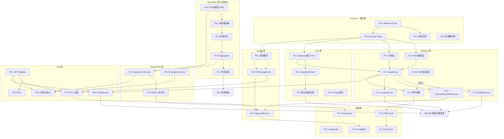

# 03 · 第一阶段开发任务树（完整展开）与依赖图

> 2026-11-12 文档复核：本文是已实施 P0–P8 的历史任务与验收清单，不是当前启动队列。新增 D-N1..3 见 [演进设计](演进设计.md)，Runtime 语义以 [当前契约](../../platform/AGENT_RUNTIME_RECOVERY.md) 覆盖旧预算成功/直接重放描述。

> 本文是 `02_AI_Game_Designer_技术设计.md` §19 的完整展开版。
> 每个任务给出：Task ID / 名称 / 目标 / 前置依赖 / 涉及文件 / 具体实现内容 / 验收标准 / 测试方式 / 可否并行。
> 总原则：**每个模块都能用 Mock 或独立入口先行测试，不被下游模块卡死。**

## 测试策略总纲（贯穿所有 Task）

| 层 | 手段 |
|---|---|
| 单元 | JUnit 5 + AssertJ；纯逻辑类（状态机/Diff/聚合器/Guard/LoopDetector）无 Spring 上下文直测 |
| 集成 | @SpringBootTest + 临时 SQLite 文件，测后删除 |
| LLM | `FakeLlmGateway`（实现 `LlmGateway` 接口，按脚本返回预设 `LlmResponse`）——Agent 相关测试不碰真实 DeepSeek |
| HTTP | MockMvc / WireMock（后者专测 DeepSeekClient 重试与错误分类） |
| E2E | 手动剧本（P8） |

---

# P0 脚手架

### P0-1 Maven 工程初始化
- **目标**：Spring Boot 3.3 + Java 21 骨架可启动，SQLite 连接可用。
- **前置依赖**：无。
- **涉及文件**：`backend/pom.xml`、`Application.java`、`resources/application.yml`、`resources/schema.sql`（10 表 DDL，见蓝图 §7）。
- **具体实现内容**：pom 仅引 web/jdbc/sqlite-jdbc/validation/jackson/test（不引 testcontainers）；application.yml 含 JDBC URL PRAGMA（WAL/busy_timeout/synchronous/foreign_keys）+ hikari max-pool-size=1 + `llm.gateway` 占位配置；schema.sql 为蓝图 §7 全部 DDL。
- **验收标准**：`mvn spring-boot:run` 成功；`data/agl.db` 自动生成且含 10 张表；`PRAGMA journal_mode`=wal。
- **测试方式**：启动冒烟 + sqlite3 CLI。
- **可并行**：与 P0-4 完全并行。

### P0-2 统一响应包络与异常体系
- **目标**：全 API 统一 `{code,message,data}` 包络与六码错误映射。
- **前置依赖**：P0-1。
- **涉及文件**：`common/ApiResp.java`、`common/BusinessException.java`、`common/ErrorCodes.java`、`api/GlobalExceptionHandler.java`。
- **具体实现内容**：ApiResp record + ok/error 工厂；BusinessException(code,msg)；@RestControllerAdvice 映射 40001/40401/40901/42901/50201/50000 + 兜底 Exception→50000。
- **错误码 → HTTP 状态契约（P0-2 验收时冻结）**：40001→400；40401→404；40901→409（含 DuplicateKeyException 与非 UNIQUE DataIntegrityViolationException）；42901→429（预留）；50201→502（预留）；50000→500（兜底）。完整表见 02 文档 §8。
- **验收标准**：Controller 抛 BusinessException 时响应为包络且 code 正确。
- **测试方式**：MockMvc 触发各异常分支。
- **可并行**：与 P0-3 并行。

### P0-3 Domain Record 与 Repository 层
- **目标**：10 个领域 record + 10 个 Repository 接口及 JdbcTemplate 实现，CRUD 全可用。
- **前置依赖**：P0-1。**不依赖 P0-2**——Repository 先抛原生异常，P0-2 落地后由 Controller 层统一转包络。
- **涉及文件**：`domain/*.java`（Task, Run, Step, ToolCall, Experiment, ConfigVersion, ChangeProposal, AgentEvent, DesignDocument, PromptVersion）、`repository/*.java`（接口 + JdbcTemplate 实现 + RowMapper）。
- **具体实现内容**：按蓝图 §7 接口清单逐个实现；JSON 列在 Repo 层经 Jackson 序列化；experiment 的 UNIQUE 冲突向上抛 DuplicateKeyException（供幂等复用判断）；RunRepository.aggregateStats 一条 SQL 出 Dashboard 数据。
- **验收标准**：10 个 Repository 各方法 CRUD 通过；UNIQUE 约束生效。
- **测试方式**：@SpringBootTest（临时库）逐 Repo 测试。
- **可并行**：与 P0-2 并行。

### P0-4 前端脚手架
- **目标**：Vite + React18 + TS + Router + React Query + ECharts 可跑，四页空壳。
- **前置依赖**：无（与后端完全并行）。
- **涉及文件**：`frontend/package.json`、`vite.config.ts`、`tsconfig.json`、`src/main.tsx`、`src/App.tsx`、`src/router.tsx`、四页空壳组件。
- **具体实现内容**：vite proxy `/api` 与 `/sse` 到 8080（sse 关缓冲）；路由 / 、/runs/:id、/experiments、/config。
- **验收标准**：`npm run dev` 打开四页空壳无报错。
- **测试方式**：手动访问 4 路由。
- **可并行**：全程可与所有后端 Task 并行。

# P1 Agent Runtime（★核心，可用 FakeLlmGateway 先行独立测试）

> **专项检查结论**：Agent Runtime **可以在 P0/P1 阶段先独立测试**——`AgentLoop` 只依赖三个接口：`LlmGateway`（用 FakeLlmGateway 脚本化替身）、`ToolRegistry`（P1 阶段注册 2~3 个 Stub Tool）、Repository（真实临时 SQLite）。因此 P1-2 起即可跑"假 LLM + 假工具"的完整循环集成测试，完全不等 P3/P4。

### P1-0 测试替身集
- **目标**：FakeLlmGateway（脚本化返回序列）+ StubTool（可编程返回值），供 P1 全程与后续回归使用。
- **前置依赖**：P0-1、P0-3。
- **涉及文件**：`llm/FakeLlmGateway.java`（test 源码集）、`tool/StubTool.java`（test）。
- **具体实现内容**：FakeLlmGateway 支持按调用序号出队预设 LlmResponse（含 tool_calls / stop / length / 抛异常四种脚本）；StubTool 实现 GameTool 接口，schema/requiresApproval/execute 结果均可编程。
- **验收标准**：单测中能驱动 AgentLoop 完成"3 步 tool_calls→第 4 步 stop"剧本。
- **测试方式**：纯 JUnit（无 Spring 也可，构造函数注入）。
- **可并行**：与 P0-2/P0-3 并行（接口签名在蓝图 §10 已冻结）。

### P1-1 Run 状态机
- **目标**：7 态状态机，非法迁移拒绝。
- **前置依赖**：P0-3。
- **涉及文件**：`runtime/RunStateMachine.java`、`runtime/RunStatus.java`。
- **具体实现内容**：静态迁移表（蓝图 §9.2 全部合法对）；transition(from,to) 校验；终态不可迁出；非法抛 BusinessException(40901)。
- **验收标准**：全部合法对通过、全部非法对被拒。
- **测试方式**：参数化单测枚举所有 49 个状态对。
- **可并行**：可与 P1-0 并行。

### P1-2 AgentLoop 主循环
- **目标**：Observe→LLM→Parse→Act→Evaluate 循环闭环。
- **前置依赖**：P1-0、P1-1。
- **涉及文件**：`runtime/AgentLoop.java`、`runtime/ToolExecutor.java`。
- **具体实现内容**：蓝图 §9.3 骨架完整实现：observe() 从 DB 重建 messages（system+user+历史 assistant/tool）；一次 LLM 调用=一个 Step；tool_calls 分支逐个执行并检查挂起；stop 分支 finalize；length 分支兜底总结 COMPLETED；每步落库+发事件（事件发布先用 NoOpPublisher 占位，P1-6 替换）。
- **验收标准**：FakeLlmGateway 剧本下 Run 从 PENDING 到 COMPLETED，steps/tool_calls 落库正确，tokens 累加正确。
- **测试方式**：@SpringBootTest 集成测（临时库+FakeLlmGateway+StubTool×2）。
- **可并行**：与 P4/P6 全并行。

### P1-3 BudgetGuard（步数/Token/时间三重预算）
- **前置依赖**：P1-2。
- **涉及文件**：`runtime/BudgetGuard.java`。
- **具体实现内容**：每轮 LLM 调用前检查 currentStep≥maxSteps / tokensUsed≥tokenBudget / now-startedAt≥timeoutSec；前两者 finalize(COMPLETED+总结)，第三者 TIMEOUT。
- **验收标准**：注入 maxSteps=2 的 Task，第 3 轮前强制结束且 finalResult 含"Max Steps"。
- **测试方式**：小预算集成测。
- **可并行**：否（顺序于 P1-2 后，但与 P2/P4/P6 并行）。

### P1-4 Cancel / Resume / Retry
- **目标**：Run 生命周期控制。
- **前置依赖**：P1-2。
- **涉及文件**：`runtime/RunControlService.java`、`runtime/RunRecoveryService.java`、`api/RunController` 的 cancel/resume/retry 端点。
- **具体实现内容**：Cancel=volatile flag 协作中断（循环每轮 Evaluate 处检测）；Resume=校验 WAITING_APPROVAL→RUNNING→重提交 executor；Retry=新建 Run 复制 task 参数；RunRecoveryService 启动扫描 RUNNING 续跑、WAITING_APPROVAL 保持挂起。
- **验收标准**：cancel 中断后状态 CANCELLED 且事件落库；重启进程（测试内模拟：新 context 扫描）RUNNING Run 被续跑。
- **测试方式**：集成测 + 手动杀进程演练。
- **可并行**：与 P2/P4/P6 并行。

### P1-5 LoopDetector 防无限循环
- **前置依赖**：P1-2。
- **涉及文件**：`runtime/LoopDetector.java`、StepRepository.countIdenticalRecentToolCalls。
- **具体实现内容**：取最近 3 次 ToolCall 计算 sha256(toolName|argumentsJson)，连续相同即判无效循环→finalize(COMPLETED,"检测到无效循环")。
- **验收标准**：FakeLlmGateway 连发 3 次同参 tool call 触发终止。
- **测试方式**：单测+集成各一。
- **可并行**：与 P2/P4/P6 并行。

### P1-6 事件发布与 SSE 推送链路
- **目标**：publish→落库→SSE 全链路通。
- **前置依赖**：P1-2（替换 NoOpPublisher）、P0-3。
- **涉及文件**：`event/AgentEventPublisher.java`、`event/AgentEventListener.java`、`event/SseEmitterRegistry.java`、`event/AgentEventType.java`（16 枚举）、`api/SseController.java`。
- **具体实现内容**：蓝图 §16 完整链路；listener 内先 insert agent_event 再推 emitter；Last-Event-ID 用自增 id 补发≤1000 条。
- **验收标准**：AgentLoop 跑一个 Fake 剧本时 `curl -N /sse/runs/{id}` 收到 STEP_STARTED/TOOL_RETURNED/RUN_COMPLETED 序列；agent_event 表行数一致。
- **测试方式**：curl -N 手测 + 集成测（MockMvc asyncDispatcher 或直接调 listener 断言落库）。
- **可并行**：SSE 部分（见 P1-6b）可提前独立做。

### P1-6b SSE 独立验证（无 Agent）
> **专项检查结论：SSE 可以单独验证。**
- **具体做法**：写一个仅测试用的 `DevEventController`（POST /sse/dev/emit?type=&payload=，仅 dev profile 生效），手动向 SseEmitterRegistry 推事件。这样不启动 Agent 即可验证：连接建立、事件到达、Last-Event-ID 补发、断线重连。
- **验收标准**：两个浏览器标签分别连 /sse/global 与 /sse/runs/1，dev emit 后均收到事件；刷新页面补发历史。
- **测试方式**：curl -N + 浏览器手测。
- **可并行**：是，仅依赖 P0-1/P0-3。

# P2 LLM Gateway（可 Mock，全程不依赖真实 DeepSeek）

> **专项检查结论**：LlmGateway **可以完全 Mock**——`FakeLlmGateway`（P1-0）实现同一接口供 Runtime 测试；真实 `DeepSeekClient` 用 WireMock 模拟 OpenAI 兼容端点做单测。真实 DeepSeek 只在 P8-2 E2E 才需要。

### P2-1 LlmGateway 接口 + DTO
- **前置依赖**：P0-1。
- **涉及文件**：`llm/LlmGateway.java`、`llm/dto/*.java`（LlmMessage/ToolCall/LlmToolSpec/LlmRequest/LlmResponse/TokenUsage）。
- **具体实现内容**：蓝图 §10 DTO 全集；接口仅 complete()（不做 streaming）。
- **验收标准**：编译通过；DTO 可序列化为 OpenAI 兼容 JSON 形状（快照测试）。
- **测试方式**：Jackson 序列化单测。
- **可并行**：是。

### P2-2 DeepSeekClient 实现
- **目标**：RestClient 直连 OpenAI 兼容 /chat/completions。
- **前置依赖**：P2-1。
- **涉及文件**：`llm/DeepSeekClient.java`、内部反序列化 DTO `DeepSeekChatResponse`。
- **具体实现内容**：POST {baseUrl}/chat/completions；Bearer auth；messages/tools/tool_calls/tool_call_id 原样映射；function.arguments 字符串透传；读超时配置化。
- **验收标准**：WireMock 返回标准响应时正确映射为 LlmResponse；返回 400 时抛 NON_RETRYABLE LlmException。
- **测试方式**：WireMock 单测。
- **可并行**：与 P1 并行。

### P2-3 重试与错误分类
- **前置依赖**：P2-2。
- **涉及文件**：`llm/GatewayRetry.java`、`llm/LlmException.java`。
- **具体实现内容**：RETRYABLE(网络超时×3、429×3 优先 Retry-After、5xx×2)指数退避 1s→2s→4s+jitter；NON_RETRYABLE(400/401/403、解析坏 JSON 限重试 1 次)直接抛。
- **验收标准**：WireMock 连续 500×3 后抛异常且恰好请求 3 次；429 带 Retry-After 时按其等待。
- **测试方式**：WireMock 场景测（退避时间在测试中调小为 ms 级配置）。
- **可并行**：与 P1/P4/P6 并行。

### P2-4 Token 统计
- **前置依赖**：P2-2、P0-3。
- **涉及文件**：`llm/dto/TokenUsage.java`、AgentLoop 内累加点。
- **具体实现内容**：每步 usage 写入 step 行并累加进 run.tokens_used。
- **验收标准**：Fake 剧本 4 步后 run.tokens_used = Σ各步 totalTokens。
- **测试方式**：集成断言。
- **可并行**：随 P1-2 验收即可。

### P2-5 Prompt 版本加载
- **前置依赖**：P0-3。
- **涉及文件**：`llm/PromptService.java`、`resources/prompts/designer_p001.md`。
- **具体实现内容**：启动时表空则导入 classpath prompt 为 p001 并置 active；PromptService.getActive() 供 observe() 使用；Run 记录 prompt_version_id。
- **验收标准**：空库启动后 prompt_version 有 p001 且 is_active=1；再次启动不重复导入。
- **测试方式**：@SpringBootTest 两次启动断言。
- **可并行**：是。

---

# P4 Simulation Engine（完全独立于 Agent，最先可测的大块）

> **专项检查结论**：Simulation Engine **可以彻底脱离 Agent 独立运行和测试**——它只依赖 GameConfig JSON（纯 Java），提供 main()/测试入口即可批量跑。甚至可以在 P0-1 之后、任何 Agent 组件之前完成并验证可复现性与性能。建议把 P4 提前到与 P2 同期并行。

### P4-0 GameConfig 模型与 v001 种子配置
- **目标**：config JSON ↔ Java 模型双向可用；v001 刻意失衡。
- **前置依赖**：无（纯 POJO + Jackson，甚至先于 P0-1）。
- **涉及文件**：`sim/GameConfig.java` 及嵌套 model 类、`resources/config/v001.json`。
- **具体实现内容**：蓝图 §12.1 全部字段（player/weapons[4]/upgrades/waves/difficulty/targets/sim）；v001 按 §12.1 失衡种子值写入。
- **验收标准**：v001.json 反序列化成功且字段值正确；targets 三项齐全。
- **测试方式**：Jackson round-trip 单测。
- **可并行**：完全独立，随时可做。

### P4-1 单局模拟器
- **目标**：确定性 tick 循环一局打完。
- **前置依赖**：P4-0。
- **涉及文件**：`sim/GameSimulator.java`、`sim/model/*`（Player/Weapon/Enemy/Projectile/Battlefield）、`sim/DamageCalculator.java`、`sim/BuildFactory.java`、`sim/WaveDirector.java`、`sim/UpgradePool.java`。
- **具体实现内容**：蓝图 §12.2 主循环六步（波次→射击→弹丸命中含穿透→敌人推进接触伤→升级加权随机→死亡判定）；所有随机经注入 SplittableRandom。
- **验收标准**：同 seed 跑两局逐字段相同；不同 seed 结果不同；600s 存活判胜、hp≤0 判死。
- **测试方式**：固定 seed 快照单测。
- **可并行**：完全独立。

### P4-2 批量并行模拟
- **前置依赖**：P4-1。
- **涉及文件**：`sim/BatchSimulator.java`。
- **具体实现内容**：串行预分裂 SplittableRandom[]（保证同 seed+count 可复现），IntStream.parallel() 消费。
- **验收标准**：10000 局两次运行聚合结果一致；多核下明显快于串行。
- **测试方式**：复现性双跑比对 + 计时。
- **可并行**：完全独立。

### P4-3 Aggregator 指标聚合
- **前置依赖**：P4-2（可与 P4-2 同时开发，接口先行）。
- **涉及文件**：`sim/Aggregator.java`、`sim/SimulationResult.java`。
- **具体实现内容**：蓝图 §12.4 全部指标：winRate/deathRate/avg/median/p90 存活时间（601 桶直方图反推）/avgDPS/avgTTK/damageHistogram[24]/buildDistribution 含 95%CI/upgradePickRate(+InWins)；线程安全累加。
- **验收标准**：小样本（如 100 局手算可验证规模）指标与手工计算一致；CI 公式正确。
- **测试方式**：构造已知分布的 GameOutcome 序列直测 Aggregator（不必真跑模拟）。
- **可并行**：是。

### P4-4 性能达标（100k 局 <60s）
- **前置依赖**：P4-1~P4-3。
- **具体实现内容**：热路径优化（预分配数组/零分配 DamageCalculator/必要时网格划分）；不达标的常见原因是每 tick new 对象与装箱。
- **验收标准**：基准机 100000 局 <60s 且结果仍可复现。
- **测试方式**：计时集成测（标注 @Tag("perf") 默认跳过，手动触发）。
- **可并行**：否，收尾性质。

---

# P6 Config Version / Proposal / Approval

> **专项检查结论**：Config Version → Change Proposal → Approval 的依赖方向**正确无环**：`modify_game_config`(Tool, P3) 创建 Proposal(P6-2)，Approval 决策流(P6-3) 唤醒 Run(P1-4 的 resume)。唯一要注意的点：**P6-3 的"唤醒"动作调用的是 P1-4 已定义好的 RunControlService.resumeRun 接口**——因此 P6 开发时可先注入 NoOpResume（或直接用 FakeLlmGateway 断言 resume 后 loop 续跑），不需要等 P3。P6 与 P1 双向只通过接口交互，无循环依赖。

### P6-1 ConfigVersionService（append-only 版本链）
- **前置依赖**：P0-3。
- **涉及文件**：`config/ConfigVersionService.java`、`resources/config/v001.json` 导入逻辑。
- **具体实现内容**：启动时空表则导入 v001；nextVersion() 在事务内取 max 序号+1 格式化 v%03d；insert 全量快照。
- **验收标准**：连续创建得到 v002/v003 严格递增；并发创建（两个线程）不重号。
- **测试方式**：单测+并发小测。
- **可并行**：是（与 P2/P4 并行）。

### P6-2 ConfigDiffer + MergePatch 应用器
- **目标**：patch 校验/应用 + 字段级 diff。
- **前置依赖**：P6-1。
- **涉及文件**：`config/ConfigDiffer.java`、`config/MergePatchApplier.java`。
- **具体实现内容**：递归展平 path→value（数组 [i] 下标）、数值归一化比较、输出 ±行与结构化 diff_json；MergePatch：校验 patch 中每个 path 在 before 中存在（防 AI 篡改结构）→ apply 得 after。
- **验收标准**：蓝图 §14 示例（critMultiplier 2.0→1.7）diff 输出正确；非法 path 被拒。
- **测试方式**：参数化单测。
- **可并行**：是。

### P6-3 ApprovalService（approve/reject 全链路）
- **前置依赖**：P6-2、P1-4（resume 接口）。
- **涉及文件**：`config/ApprovalService.java`、`api/ProposalController.java`。
- **具体实现内容**：approve：校验 PENDING→事务内建新版本+回填 targetVersion→事务提交后发 CONFIG_VERSION_CREATED 事件→resumeRun(runId)（tool result 注入 APPROVED+newVersion）；reject：置 REJECTED→resumeRun（tool result 注入 REJECTED+comment）。**开发期可用 FakeLlmGateway 断言：resume 后 Agent 收到的 tool 消息含 APPROVED/REJECTED。**
- **验收标准**：approve 后出现 v(n+1)、proposal 状态 APPROVED、关联 Run 恢复 RUNNING；reject 对称。
- **测试方式**：@SpringBootTest 全链路（FakeLlmGateway 驱动的迷你 AgentLoop 或直接调用 suspend/resume）。
- **可并行**：与 P2/P4 并行（只需 P1-4 的接口签名冻结，不需其完整实现——可先用内存桩 resume）。

# P5 Experiment 服务

### P5-1 ExperimentService（幂等落库）
- **前置依赖**：P4-2/P4-3、P0-3。
- **涉及文件**：`experiment/ExperimentService.java`。
- **具体实现内容**：create(configVersion,seed,count,scenario)：先查 UNIQUE 命中则直接返回已有结果(reused=true)；否则插入 RUNNING 行→BatchSimulator 跑→complete() 回填指标+result_json。同步执行（10000 局 ~10s 可接受），P5-3 再异步化。
- **验收标准**：同参数两次调用第二次秒回且 experimentId 相同；不同 configVersion 正常新算。
- **测试方式**：集成测（用小 count=200 控制时长）。
- **可并行**：依赖 P4，但与 P1/P3 无耦合。

### P5-2 EvaluationService（目标校验器）
- **前置依赖**：P4-3（读 SimulationResult）、P0-3（读 targets）。
- **涉及文件**：`experiment/EvaluationService.java`。
- **具体实现内容**：对照 config.targets（targetWinRate/acceptableBuildDpsVariance/maxDominantBuildShare）输出 pass/fail 逐项摘要文本——analyze_experiment 工具复用它。
- **验收标准**：构造超差样本输出"未达标+哪项超差"；达标样本全过。
- **测试方式**：单测（构造 SimulationResult 直测，不跑模拟）。
- **可并行**：是。

### P5-3 Experiment REST + 异步化
- **前置依赖**：P5-1、P0-2。
- **涉及文件**：`api/ExperimentController.java`、`experiment/AsyncSimulationRunner.java`。
- **具体实现内容**：列表/详情/compare(算 Δ 与 z 显著性)/run(手动触发,单线程 Executor 异步,202)；完成发 SIMULATION_COMPLETED 事件。
- **验收标准**：四端点联调通过；手动 run 提交即返 202，完成后 SSE 收到事件。
- **测试方式**：MockMvc + 集成。
- **可并行**：与前端 P7 并行。

---

# P3 Tool Registry（依赖各服务接口，最后组装）

> **专项检查结论**：Tool Registry **可以脱离 Agent 独立测试**——ToolRegistry.dispatch(name,argsJson) 本身就是纯 Java 入口：单测直接 new ToolRegistry(List.of(tools)) 调 dispatch 断言 ToolResult，完全不需要 AgentLoop。每个具体 Tool 也各自只依赖一个 Service，可逐一桩测。

### P3-1 GameTool SPI + ToolRegistry
- **前置依赖**：P0-3。
- **涉及文件**：`tool/GameTool.java`、`tool/ToolRegistry.java`、`tool/ToolContext.java`、`tool/ToolResult.java`。
- **具体实现内容**：接口四方法（name/jsonSchema/requiresApproval/execute）；Registry 构造注入 List<GameTool> 建 name→tool 映射，重名启动即失败；dispatch 校验未知 tool 名。**独立测试入口：直接调 registry.dispatch()。**
- **验收标准**：注册 8 个后 size()==8；未知名抛 BusinessException；重名导致启动失败。
- **测试方式**：纯单测（无 Spring）。
- **可并行**：是。

### P3-2 读类工具 ×2
- **前置依赖**：P3-1、P6-1。
- **涉及文件**：`tool/GetGameDesignTool.java`、`tool/GetGameConfigTool.java`、`resources/docs/game_design.md`。
- **具体实现内容**：get_game_design 读 classpath 静态设计文档；get_game_config 读指定版本(缺省最新)全量 JSON。schema 定义见蓝图 §11。
- **验收标准**：dispatch("get_game_config",{}) 返回当前版本 JSON 且含 version 字段。
- **测试方式**：单测（临时库插一版断言读取）。
- **可并行**：是。

### P3-3 写类工具 ×2（含审批挂起）
- **前置依赖**：P3-1、P6-2、P1-4 的 suspend 能力。
- **涉及文件**：`tool/ModifyGameConfigTool.java`、`tool/CreateChangeProposalTool.java`。
- **具体实现内容**：modify_game_config：MergePatch apply→diff→落 PENDING proposal→发 PROPOSAL_CREATED/APPROVAL_REQUIRED 事件→返回特殊 ToolResult(suspended=true) 让 ToolExecutor 挂起 Run；create_change_proposal：仅落方案论证文档型 proposal，不碰配置、不挂起。**注意：本 Task 是 P6-3 审批流的另一半，二者通过 change_proposal 表解耦，无循环依赖。**
- **验收标准**：dispatch modify 后 proposal 表多一行 PENDING、diff_json 正确；Run 进入 WAITING_APPROVAL（配合迷你 loop 测）。
- **测试方式**：集成测。
- **可并行**：与 P4/P7 并行。

### P3-4 实验/文档工具 ×3
- **前置依赖**：P3-1、P5-1、P5-2。
- **涉及文件**：`tool/SimulateGameTool.java`、`tool/AnalyzeExperimentTool.java`、`tool/CompareExperimentsTool.java`、`tool/CreateDesignDocumentTool.java`（共 4 个，含文档）。
- **具体实现内容**：simulate_game 参数校验(count≤100000)后调 ExperimentService；analyze 输出紧凑指标文本表（复用 EvaluationService）；compare 输出 Δ+z 显著性表；create_design_document 落 design_document 表。所有大结果经截断器（上限 ~4000 字符）回传防 token 爆炸。
- **验收标准**：simulate 幂等（同参 reused）；analyze 返回文本含胜率/CI；compare 含 Δ 列。
- **测试方式**：单测+集成（小 count）。
- **可并行**：是。

### P3-5 ToolExecutor 编排
- **目标**：AgentLoop 与 Tool 之间的调度层：落库/计时/异常捕获/审批拦截/结果截断。
- **前置依赖**：P3-1、P1-2。
- **涉及文件**：`runtime/ToolExecutor.java`。
- **具体实现内容**：蓝图 §9.3 executeTool 逻辑：STARTED 落库→requiresApproval?挂起:执行→COMPLETED/FAILED 落库→发 TOOL_CALLED/TOOL_RETURNED 事件；ToolException 捕获写 error 不中断 Run（critical 除外）。
- **验收标准**：StubTool 抛异常时 Run 继续（tool_call.status=FAILED 且 LLM 下轮收到错误 observation）。
- **测试方式**：集成测（FakeLlmGateway 剧本：失败 tool→模型改走 stop）。
- **可并行**：随 P1-2。

---

# P7 Frontend 功能页（API 契约冻结后全部并行）

### P7-1 Layout + Dashboard
- **前置依赖**：P0-4、P0-2、P8 前的任意可用 `/api/dashboard/stats`（可在 P0-2 后先给占位实现）。
- **涉及文件**：`pages/DashboardPage.tsx`、`components/layout/AppLayout.tsx`、`components/stat/StatTile.tsx`、`components/charts/*`。
- **具体实现内容**：蓝图 §17 Dashboard 布局：6 StatTile+4 图+最近 Runs+事件流。
- **验收标准**：真实后端数据显示；空库不白屏。
- **测试方式**：手动。
- **可并行**：与其余 P7 并行。

### P7-2 全局 SSE Hook + 降级轮询
- **前置依赖**：P1-6、P0-4。
- **涉及文件**：`hooks/useGlobalSse.ts`、`hooks/useRunSse.ts`。
- **具体实现内容**：EventSource 封装、eventId 去重、React Query invalidateQueries 失效广播、连续失败降级 refetchInterval 轮询。
- **验收标准**：杀后端重启后页面数据自愈；（配 DevEventController）emit 事件后相关查询自动刷新。
- **测试方式**：手动+DevEventController。
- **可并行**：是。

### P7-3 Run Trace 页
- **前置依赖**：P7-2、P1-6、`GET /api/runs/{id}` 就绪。
- **涉及文件**：`pages/RunTracePage.tsx`、`components/run/*`（StepTimeline/StepDetailDrawer/ApprovalBanner）。
- **具体实现内容**：左 Run 列表+右垂直时间线+Drawer 详情+SSE 增量 append+WAITING_APPROVAL 横幅跳 Config 页+Cancel/Retry 按钮。
- **验收标准**：Fake 剧本 Run 运行中实时滚动出新 Step。
- **测试方式**：起 Fake Run 观察。
- **可并行**：与其他页面并行。

### P7-4 Experiment Center 页
- **前置依赖**：P5-3、P7-1 图表组件。
- **涉及文件**：`pages/ExperimentCenterPage.tsx`、`components/exp/*`。
- **具体实现内容**：过滤表格+勾选≤4 对比+五组图（指标柱状/Build 分布堆叠/平衡度雷达/PickRate 条形/伤害构成）。
- **验收标准**：对比随勾选刷新；delta 高亮正负色。
- **测试方式**：手动（用 P5 数据）。
- **可并行**：是。

### P7-5 Config & Diff 页（含审批操作）
- **前置依赖**：P6-3 的 REST、P7-2。
- **涉及文件**：`pages/ConfigDiffPage.tsx`、`components/config/*`（VersionSelect/DiffView/ProposalCard）。
- **具体实现内容**：左版本树+中配置查看(只读 JSON)+Diff ±行渲染+右待审批卡（标题/理由/依据实验链接/Diff/Approve/Reject(comment)）。
- **验收标准**：走一次完整 approve 后版本列表即时出现 v(n+1)（SSE 驱动刷新）。
- **测试方式**：手动脉冲全流程。
- **可并行**：是。

# P8 E2E 与收尾

### P8-1 一键启动脚本
- **前置依赖**：P0-1、P0-4。
- **涉及文件**：`scripts/dev.bat`（Windows）/`scripts/dev.sh`、README 运行说明。
- **具体实现内容**：并行起后端(mvn spring-boot:run 或 java -jar)与前端(npm run dev)；提供 `scripts/reset-db.bat` 清 data/。
- **验收标准**：两条命令全流程可用。
- **测试方式**：手动。
- **可并行**：可提前做。

### P8-2 金色路径 E2E（首次使用真实 DeepSeek）
- **前置依赖**：全部功能 Task。
- **具体实现内容**：手动剧本——提交"平衡三种 Build"→观察 Trace→审批提案→复测对比→设计文档产出。**这是全项目第一次调用真实 DeepSeek API**（此前全部用 Fake/WireMock）。
- **验收标准**：蓝图 §21 验收 1~7 全过；全程除 Approve 无人工干预。
- **测试方式**：剧本逐项打勾，截图留档。
- **可并行**：否。

### P8-3 性能验收
- **前置依赖**：P4-4。
- **具体实现内容**：100k 局基准计时+同 seed 双跑比对写入 README 基准表。
- **测试方式**：@Tag("perf") 手动跑。
- **可并行**：可在 P4 完成后随时插入。

### P8-4 异常路径演练
- **前置依赖**：P8-2。
- **具体实现内容**：断 API Key→Run FAILED+50201 事件；中途 Cancel→CANCELLED；杀进程重启→RUNNING Run 恢复/WAITING_APPROVAL 保持；maxSteps=3 小预算→触顶总结。
- **验收标准**：各终态正确、agent_event 记录完整。
- **测试方式**：手动逐项。

---

# 专项检查结论汇总

| # | 检查项 | 结论 | 机制 |
|---|---|---|---|
| 1 | Agent Runtime 能否 P0/P1 先独立测试 | ✅ | AgentLoop 仅依赖 LlmGateway 接口 + ToolRegistry + Repository；P1-0 提供 FakeLlmGateway+StubTool，P1-2 即可全闭环测试，不等 P3/P4/P6 |
| 2 | LlmGateway 可否 Mock 不碰真实 DeepSeek | ✅ | 接口抽象（FakeLlmGateway 测 Runtime）+ WireMock 测 DeepSeekClient 本身；真实 API 只在 P8-2 首次出现 |
| 3 | Simulation 可否脱离 Agent 独立运行 | ✅ | 纯 Java + GameConfig JSON；P4-0 起完全独立，甚至建议提前到与 P2 同期并行 |
| 4 | Tool Registry 可否脱离 Agent 独立测试 | ✅ | registry.dispatch() 是纯 Java 入口；每个 Tool 只依赖单一 Service 可桩测 |
| 5 | SSE 可否单独验证 | ✅ | dev profile 的 DevEventController 手动 emit；连接/补发/重连均无需 Agent |
| 6 | Config/Proposal/Approval 依赖链是否正确 | ✅ | modify_game_config(P3-3) 写 proposal 表 → ApprovalService(P6-3) 读它并 resume → resume 是 P1-4 定义的接口。三方只通过 DB 行和接口交互，无环。开发期 P6-3 可用内存桩 resume 先行 |
| 7 | 是否存在"前面依赖后面"的循环依赖 | ✅ 无 | 唯一疑似点：P3-3(写 tool) ↔ P6-3(审批) —— 解耦为：P3-3 只写 change_proposal 表，P6-3 只读该表并调 resume 接口，二者互不 import 对方实现类 |

---

# Task Dependency Graph



## 并行泳道（时间轴视角）

```text
周次 →   W1            W2            W3            W4          W5
泳道A    P0-1 ─ P0-3 ─ P0-2 ─┐
泳道B    P0-4(前端)───────── P7-1 ── P7-2 ── P7-3/P7-4/P7-5 ──┐
泳道C           P4-0 ─ P4-1 ─ P4-2/P4-3 ─ P4-4 ─ P5-1 ─ P5-3 ─┤
泳道D           P2-1 ─ P2-2 ─ P2-3 ────────────────────────┤→ P8-2 E2E
泳道E           P6-1 ─ P6-2 ─────────── P6-3 ─────────────┤  P8-1/P8-4
泳道F                  P1-0 ─ P1-1 ─ P1-2 ─ P1-3/P1-4/P1-5 ─┤
泳道G                         P1-6b(SSE)      P1-6 ─────────┤
泳道H                                P3-1 ─ P3-2/P3-4 ─ P3-3/P3-5 ┘
汇合                                        P3-5/P1-6 完成后 → P8
```

## P0-1 完成后，下一步最适合做什么？

**推荐：立即并行启动三条线——P0-3（Domain+Repository）、P0-4（前端脚手架）、P4-0+P4-1（Config 模型+单局模拟器）。**

理由：

1. **P0-3 是全局枢纽**：几乎所有后续 Task（P1/P2-4/P2-5/P3/P5/P6）都依赖 Repository。它不依赖 P0-2（包络），做完即解锁最大宽度的下游。P0-2 只是薄薄一层 HTTP 包装，随时可补。
2. **P4-0/P4-1 是零风险的高价值支线**：模拟器纯 Java、无任何 Spring/Agent 依赖，可以立刻验证本项目最核心的资产——"数值模拟可复现"。它越早跑通，P5/P3-4 的联调风险越早消除；若数值模型需要调整（手感/失衡度），改动窗口也最早。
3. **P0-4 与后端零耦合**：前端脚手架只消费 API 契约（已在蓝图 §8 冻结），并行推进不产生任何等待。

**为什么不先做 P2（LLM Gateway）？** 它也可并行，但 DeepSeekClient 的 WireMock 测试价值集中在 P1-2 接入时才兑现；而 FakeLlmGateway（P1-0）本身不依赖 P2 的真实实现——接口签名冻结即可。因此 P2 放在 P0-3 之后与 P1-0 并行即可，不抢第一优先级。

**严格串行的唯一主线**是：P0-3 → P1-0 → P1-1 → P1-2。这条线走完，项目就有了"会呼吸的 Agent"（Fake 驱动的完整循环），此后一切模块都是往这条循环上挂真实实现。
