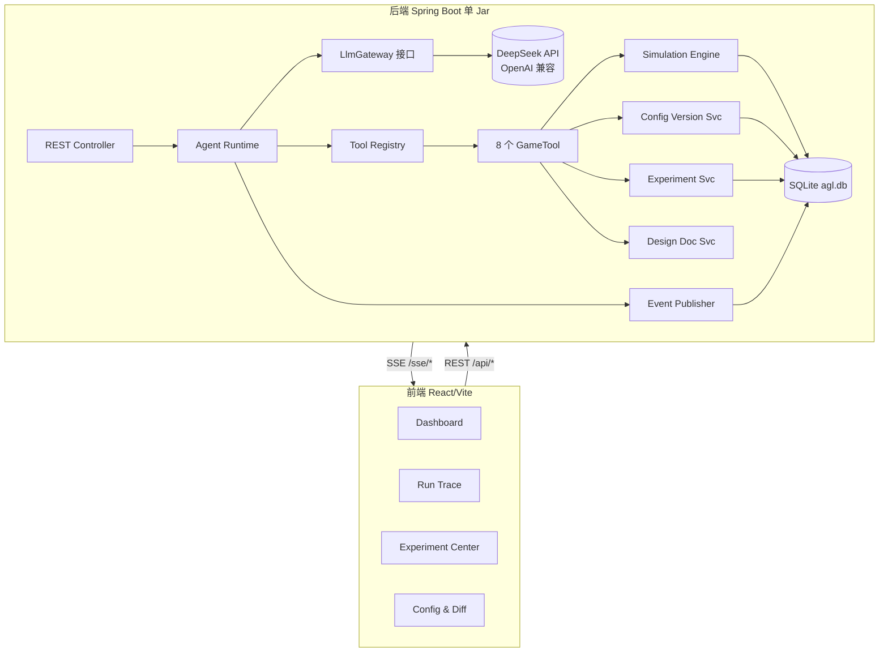
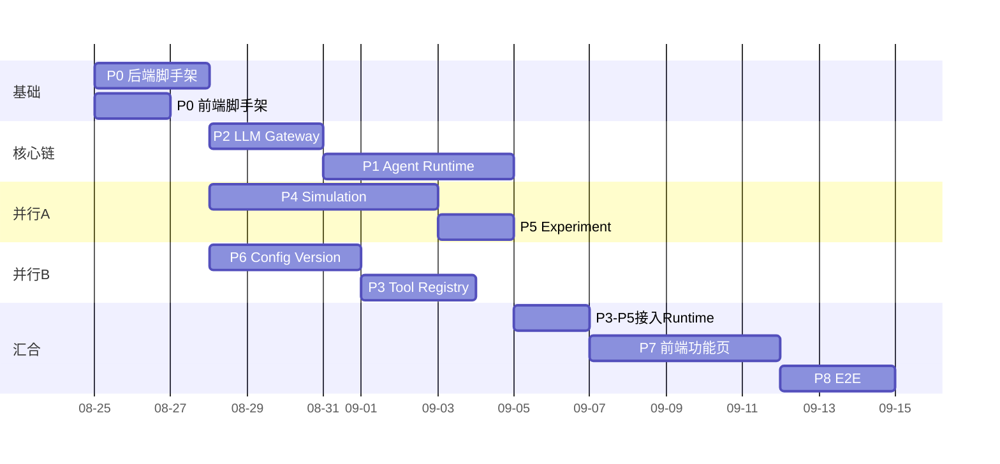

# AI Game Lab 第一阶段 — AI Game Designer 技术设计

> 2026-11-12 文档复核：本文保留 P0–P8 的 ORBITAL 技术基线；后续编码不能直接照抄旧 Runtime 伪代码。当前运行契约见 [Runtime](../../platform/AGENT_RUNTIME_RECOVERY.md)，新作与真实游戏设计见 [演进设计](演进设计.md)。旧字段/API/性能目标须按现代码和对应测试核对；产品范围以 [产品定义](产品定义.md) 为准。

> 范围：AI Game Designer Agent + 游戏数值模拟器 + 中台监控。
> 不明确实现：AI 自动测试 / QA Team / Research Agent / Autonomous Builder。
> 本文件保留早期工程蓝图；当前实现差异及新增设计以上方复核入口为准。

---

## 1. 项目理解

我们要做一个**能真正干活的 AI 游戏策划**，而不是聊天机器人。用户给一句目标（"三种 Build 强度差距太大，请平衡"），Agent 自主完成：理解→读配置→读设计→跑模拟→分析→提方案→调模拟器验证→生成修改提案→等批准→改配置→复测→对比→迭代→出报告。整个过程在中台全程可见、可批准、可回滚。

第一阶段是**验证性 MVP**：个人开发者、本地一键起、不堆基础设施。技术债允许存在，但"可复现、可观测、可追踪、可回滚"四条红线不能妥协。

---

## 2. MVP 定义

**最小可运行闭环**：提交一个平衡目标 → Agent 跑出一条完整 Run Trace（含 ≥1 次 `simulate_game` + `modify_game_config` 挂起）→ 中台批准 → 生成新 Config 版本 → 再跑模拟 → 前后对比结果出现在 Experiment Center。

**MVP 成功判据**：上述闭环在本地 `java -jar` 后端 + `npm run dev` 前端跑通，且同 (configVersion, seed, count, scenario) 两次结果完全一致。

---

## 3. 技术栈最终选择

| 层 | 选择 | 理由 |
|---|---|---|
| 语言/后端 | Java 21 + Spring Boot 3.3 + Maven | 你指定；生态成熟 |
| 前端 | React 18 + TypeScript + Vite + ECharts + React Query + react-router | 你指定；ECharts 满足图表，React Query 覆盖服务端状态 |
| 持久化 | **SQLite**（xerial `sqlite-jdbc` + `JdbcTemplate`） | 零部署单文件；事务+查询+并发写（WAL）全满足；JSON 文件方案无事务/无查询/需自写文件锁，**否决** |
| JSON 处理 | Jackson（手工序列化 TEXT 列） | SQLite 无原生 JSON 类型；不引 json1 查询函数（过度设计） |
| AI | 统一 `LlmGateway` 接口 + `DeepSeekClient`（OpenAI 兼容 REST，用 Spring `RestClient`，**不引 SDK**） | 业务代码禁止出现 DeepSeek/OpenAI import |
| 实时 | Spring `ApplicationEvent` + `SseEmitter` + SQLite 事件表 | 替代 Kafka；单机 MVP 足够 |
| Schema 管理 | `schema.sql` + `CREATE TABLE IF NOT EXISTS`，启动即建 | 不引 Flyway/Liquibase（第一阶段用不到） |

**SQLite 关键配置**（写进 JDBC URL，每条连接自动生效）：
```
jdbc:sqlite:./data/agl.db?journal_mode=WAL&busy_timeout=5000&synchronous=NORMAL&foreign_keys=ON
```
`spring.datasource.hikari.maximum-pool-size=1` —— SQLite 同时只允许一个写者，单连接池限制本进程并发访问；外部连接、长事务与嵌套借连接仍需控制，不能保证所有负载下无锁等待。

---

## 4. 总体技术架构



**模块通信方式**：
- Ctrl→Runtime：同步方法调用（提交 Task/Run、Cancel/Approve）。
- Runtime→LLM：通过 `LlmGateway.complete()`（阻塞式，带重试）。
- Runtime→Tool：经 `ToolRegistry.dispatch()`（参数校验→权限→审批拦截→执行→结果包装）。
- 任何关键行为→`AgentEventPublisher.publish()`：同步发 `DomainEventEnvelope` → `@EventListener` 先落 `agent_event` 表、后推 `SseEmitter`。
- 前端：REST 取数据 + SSE 收"信号"触发 React Query 局部 refetch（SSE 只做信号，不承载数据本身）。

---

## 5. 项目目录结构

```
ai-game-lab/
├── docs/                        # 设计文档（你提供的两份 md 归入此处）
├── data/                        # 运行时 SQLite 文件 agl.db（gitignore）
├── backend/
│   ├── pom.xml
│   └── src/main/java/com/aigamelab/
│       ├── Application.java
│       ├── api/                # REST Controller + DTO + 全局异常处理
│       │   ├── TaskController / RunController / ProposalController
│       │   ├── ExperimentController / ConfigController
│       │   ├── DashboardController / SseController
│       │   ├── dto/           # 请求/响应 DTO（record）
│       │   └── GlobalExceptionHandler.java
│       ├── runtime/           # ★核心：Agent Runtime
│       │   ├── AgentLoop.java          # 主循环
│       │   ├── RunStateMachine.java     # 7 态状态机
│       │   ├── BudgetGuard.java         # MaxSteps/Token/Timeout
│       │   ├── LoopDetector.java        # 防无限循环
│       │   ├── RunControlService.java   # Cancel/Resume/Retry
│       │   ├── RunRecoveryService.java  # 启动扫描恢复
│       │   └── ToolExecutor.java        # tool 调度+落库+超时
│       ├── llm/               # LLM Gateway
│       │   ├── LlmGateway.java          # 接口
│       │   ├── DeepSeekClient.java      # 实现（RestClient）
│       │   ├── dto/                    # LLMMessage/ToolCall/Request/Response/Usage
│       │   ├── GatewayRetry.java
│       │   └── PromptService.java       # System Prompt 版本化
│       ├── tool/              # Tool Registry + 8 个 Tool
│       │   ├── GameTool.java            # 工具接口
│       │   ├── ToolRegistry.java        # 启动扫描注册
│       │   ├── ToolContext.java
│       │   ├── GetGameDesignTool / GetGameConfigTool
│       │   ├── ModifyGameConfigTool / SimulateGameTool
│       │   ├── AnalyzeExperimentTool / CompareExperimentsTool
│       │   ├── CreateDesignDocumentTool / CreateChangeProposalTool
│       │   └── schemas/                 # 各 tool 的 JSON Schema 常量
│       ├── sim/               # Simulation Engine
│       │   ├── model/        # Player/Weapon/Enemy/Projectile/Upgrade/Wave
│       │   ├── GameSimulator.java       # 单局
│       │   ├── BatchSimulator.java      # 批量并行
│       │   ├── DamageCalculator.java    # 纯函数
│       │   ├── BuildFactory.java        # build→武器/升级池装配
│       │   ├── UpgradePool.java
│       │   ├── WaveDirector.java
│       │   ├── Aggregator.java          # 聚合结果
│       │   └── GameConfig.java          # 配置模型（JSON 反序列化）
│       ├── experiment/        # Experiment 服务
│       │   ├── ExperimentService.java
│       │   └── EvaluationService.java   # 对照 targets 判定达标
│       ├── config/           # Config Version 系统
│       │   ├── ConfigVersionService.java
│       │   ├── ConfigDiffer.java        # 字段级 diff
│       │   └── ApprovalService.java     # approve/reject 全链路
│       ├── event/            # 事件系统
│       │   ├── AgentEventPublisher.java
│       │   ├── AgentEventListener.java  # 落库+推送
│       │   ├── SseEmitterRegistry.java
│       │   └── AgentEventType.java      # 16 枚举
│       ├── design/           # 设计文档服务
│       │   └── DesignDocumentService.java
│       ├── domain/           # 领域 record/entity
│       ├── repository/       # 9 个 Repository 接口+JdbcTemplate 实现
│       └── resources/
│           ├── schema.sql
│           ├── application.yml
│           ├── prompts/designer_p001.md  # 初始 System Prompt
│           └── config/v001.json          # 初始种子配置
└── frontend/
    ├── package.json / vite.config.ts / tsconfig.json
    └── src/
        ├── main.tsx / App.tsx / router.tsx
        ├── api/        # client.ts / types.ts / endpoints.ts
        ├── pages/      # Dashboard / RunTrace / ExperimentCenter / ConfigDiff
        ├── components/ # layout/stat/charts/run/exp/config
        ├── hooks/      # useGlobalSse.ts / useRunSse.ts / useApiQuery.ts
        └── types/      # events.ts 等
```

每个包存在的理由：以上已逐项标注。`design/` 与 `experiment/` 拆开是为了让 `create_design_document` 与 `simulate_game` 各自内聚；`runtime/tool/` 拆分让"循环控制"与"工具实现"互不污染。

---

## 6. 数据模型

领域实体（Java `record`）：`Task`, `Run`, `Step`, `ToolCall`, `Experiment`, `ConfigVersion`, `ChangeProposal`, `AgentEvent`, `DesignDocument`, `PromptVersion`。

**Run 状态机**（7 态）见 §9。**Step 与 ToolCall 关系**：一次 LLM 调用 = 1 个 Step；1 个 Step 可含 0~N 个 ToolCall（独立表，便于 Resume 精确定位）。

---

## 7. Repository / Persistence 设计

**10 张表 DDL**（建表语句见后端 `resources/schema.sql`；早期文档写"9 张表"为笔误——§7 实际定义含 prompt_version 共 10 张）：

```sql
-- 用户目标
CREATE TABLE IF NOT EXISTS task (
    id INTEGER PRIMARY KEY AUTOINCREMENT,
    title TEXT NOT NULL, goal TEXT NOT NULL,
    constraints_json TEXT NOT NULL DEFAULT '{}',
    max_steps INTEGER NOT NULL DEFAULT 30,
    approval_required INTEGER NOT NULL DEFAULT 1,
    status TEXT NOT NULL DEFAULT 'ACTIVE',
    created_at TEXT NOT NULL DEFAULT (datetime('now','localtime')) );

-- 一次 Agent 执行
CREATE TABLE IF NOT EXISTS run (
    id INTEGER PRIMARY KEY AUTOINCREMENT,
    task_id INTEGER NOT NULL REFERENCES task(id),
    status TEXT NOT NULL DEFAULT 'PENDING',
    prompt_version_id INTEGER REFERENCES prompt_version(id),
    model TEXT NOT NULL DEFAULT 'deepseek-chat',
    current_step INTEGER NOT NULL DEFAULT 0,
    max_steps INTEGER NOT NULL DEFAULT 30,
    token_budget INTEGER NOT NULL DEFAULT 200000,
    tokens_used INTEGER NOT NULL DEFAULT 0,
    error_message TEXT, final_result TEXT,
    started_at TEXT, finished_at TEXT,
    created_at TEXT NOT NULL DEFAULT (datetime('now','localtime')) );
CREATE INDEX IF NOT EXISTS idx_run_task_status ON run(task_id, status);

-- 一次 LLM 循环（与 ToolCall 拆表，见 §5 理由）
CREATE TABLE IF NOT EXISTS step (
    id INTEGER PRIMARY KEY AUTOINCREMENT,
    run_id INTEGER NOT NULL REFERENCES run(id),
    seq INTEGER NOT NULL,
    phase TEXT NOT NULL,             -- LLM_CALL / FINAL_ANSWER / ERROR
    llm_content TEXT,                -- 模型文本（决策摘要，非隐藏 CoT）
    prompt_tokens INTEGER NOT NULL DEFAULT 0,
    completion_tokens INTEGER NOT NULL DEFAULT 0,
    duration_ms INTEGER,
    created_at TEXT NOT NULL DEFAULT (datetime('now','localtime')),
    UNIQUE(run_id, seq) );
CREATE INDEX IF NOT EXISTS idx_step_run ON step(run_id);

-- 工具调用（独立表，支持一个 Step 多个 tool + 精确 Resume）
CREATE TABLE IF NOT EXISTS tool_call (
    id INTEGER PRIMARY KEY AUTOINCREMENT,
    step_id INTEGER NOT NULL REFERENCES step(id),
    run_id INTEGER NOT NULL REFERENCES run(id),
    tool_name TEXT NOT NULL,
    arguments_json TEXT,
    result_json TEXT,
    status TEXT NOT NULL DEFAULT 'STARTED',   -- STARTED/COMPLETED/FAILED
    approval_status TEXT NOT NULL DEFAULT 'NOT_REQUIRED', -- NOT_REQUIRED/PENDING/APPROVED/REJECTED
    started_at TEXT, ended_at TEXT, error TEXT );
CREATE INDEX IF NOT EXISTS idx_tc_run ON tool_call(run_id);

-- 可复现实验（result 内嵌，不拆表；冗余列供列表过滤）
CREATE TABLE IF NOT EXISTS experiment (
    id INTEGER PRIMARY KEY AUTOINCREMENT,
    run_id INTEGER REFERENCES run(id),
    config_version TEXT NOT NULL,
    seed INTEGER NOT NULL,
    simulation_count INTEGER NOT NULL,
    scenario TEXT NOT NULL DEFAULT 'ALL_BUILDS',
    status TEXT NOT NULL DEFAULT 'RUNNING',
    win_rate REAL, avg_dps REAL, avg_game_time_s REAL,
    result_json TEXT,
    duration_ms INTEGER,
    created_at TEXT NOT NULL DEFAULT (datetime('now','localtime')),
    UNIQUE(config_version, seed, simulation_count, scenario) );
CREATE INDEX IF NOT EXISTS idx_exp_cfg ON experiment(config_version);

-- 配置版本（append-only 全量快照）
CREATE TABLE IF NOT EXISTS game_config_version (
    version TEXT PRIMARY KEY,
    config_json TEXT NOT NULL,
    parent_version TEXT,
    change_proposal_id INTEGER,
    comment TEXT,
    created_at TEXT NOT NULL DEFAULT (datetime('now','localtime')) );

-- 变更提案（Human-in-the-loop 核心）
CREATE TABLE IF NOT EXISTS change_proposal (
    id INTEGER PRIMARY KEY AUTOINCREMENT,
    run_id INTEGER REFERENCES run(id),
    base_version TEXT NOT NULL,
    target_version TEXT,
    title TEXT NOT NULL, reason TEXT NOT NULL,
    evidence_experiment_ids TEXT NOT NULL DEFAULT '[]',
    diff_json TEXT NOT NULL,            -- [{path,before,after}]
    after_config_json TEXT NOT NULL,    -- 批准后落库的全量快照
    status TEXT NOT NULL DEFAULT 'PENDING', -- PENDING/APPROVED/REJECTED
    decided_at TEXT, decided_comment TEXT,
    created_at TEXT NOT NULL DEFAULT (datetime('now','localtime')) );
CREATE INDEX IF NOT EXISTS idx_proposal_status ON change_proposal(status);

-- 事件流（持久化 + SSE 源，替代消息队列）
CREATE TABLE IF NOT EXISTS agent_event (
    id INTEGER PRIMARY KEY AUTOINCREMENT,
    event_id TEXT NOT NULL UNIQUE,
    type TEXT NOT NULL, run_id TEXT, task_id TEXT,
    payload_json TEXT NOT NULL DEFAULT '{}',
    created_at TEXT NOT NULL DEFAULT (datetime('now','localtime')) );
CREATE INDEX IF NOT EXISTS idx_event_run ON agent_event(run_id, id);

CREATE TABLE IF NOT EXISTS design_document (
    id INTEGER PRIMARY KEY AUTOINCREMENT,
    run_id INTEGER REFERENCES run(id), task_id INTEGER REFERENCES task(id),
    title TEXT NOT NULL, content_md TEXT NOT NULL,
    created_at TEXT NOT NULL DEFAULT (datetime('now','localtime')) );

CREATE TABLE IF NOT EXISTS prompt_version (
    id INTEGER PRIMARY KEY AUTOINCREMENT,
    version TEXT NOT NULL UNIQUE,
    system_prompt TEXT NOT NULL, description TEXT,
    is_active INTEGER NOT NULL DEFAULT 0,
    created_at TEXT NOT NULL DEFAULT (datetime('now','localtime')) );
```

**Repository 接口清单**（每个返回领域 record，JSON 列在 Repo 层用 Jackson 序列化）：
- `TaskRepository`: insert / findById / findAll / updateStatus
- `RunRepository`: insert / findById / findByTask / updateStatusAndStep / finish(原子收尾) / aggregateStats
- `StepRepository`: insert / findByRunId(seq 升序) / countIdenticalRecentToolCalls(runId,tool,args,window)
- `ToolCallRepository`: insert / findByStep / findByRun / updateStatus
- `ExperimentRepository`: insert(UNIQUE 冲突抛异常) / complete / findById / findByFilter / findByIds
- `ConfigVersionRepository`: insert / findByVersion / findLatest / findAll
- `ChangeProposalRepository`: insert / findById / findByStatus / decide
- `AgentEventRepository`: insert / findByRunIdAfter / findRecent
- `DesignDocumentRepository`: insert / findById / findByTaskId
- `PromptVersionRepository`: findActive / insert / setActive

---

## 8. API 设计

统一响应包络：`{ "code": 0, "message": "ok", "data": {} }`；错误码 `40001/40401/40901/42901/50201/50000`（极简六码，`@RestControllerAdvice` 统一转换）。

**错误码 → HTTP 状态映射（P0-2 验收时冻结的 API Error Contract）**：

| code | HTTP | 语义 | 触发来源 |
|---|---|---|---|
| 40001 | 400 | 参数校验失败 / 请求非法 | `MethodArgumentNotValidException`、`HttpMessageNotReadableException`、类型不匹配、`IllegalArgumentException` |
| 40401 | 404 | 资源不存在 | `BusinessException.notFound()`、未路由路径（`NoResourceFoundException`） |
| 40901 | 409 | 资源冲突 / 状态机违规 | `BusinessException.conflict()`（如 P1-1 Run 状态机）；`DuplicateKeyException`（SQLite UNIQUE，幂等复用场景）；非 UNIQUE 的 `DataIntegrityViolationException` |
| 42901 | 429 | 触发限流 | 当前预留（P0 阶段无触发场景） |
| 50201 | 502 | 上游 LLM 网关异常 | 当前预留（P8-4 异常演练启用） |
| 50000 | 500 | 未知内部错误（兜底） | 兜底 `Exception`：堆栈仅写日志，响应固定文案，零信息泄漏 |

实现锚点：`backend/src/main/java/com/aigamelab/common/ErrorCodes.java`、`api/GlobalExceptionHandler.java`。

### Task & Run
| 方法 | 路径 | 说明 |
|---|---|---|
| POST | `/api/tasks` | 创建任务 `{title,goal,constraints,maxSteps?,approvalRequired?}` |
| GET | `/api/tasks` | 任务列表 |
| GET | `/api/tasks/{id}` | 任务详情（含最近 runs） |
| POST | `/api/tasks/{id}/runs` | 发起一次 Agent 执行 → 返回 `RunDto`(PENDING) |
| GET | `/api/runs` | Run 列表 |
| GET | `/api/runs/{id}` | Run 详情（steps + tool_calls + tokens + finalResult） |
| GET | `/api/runs/{id}/events?afterEventId=` | 事件历史（断线补偿） |
| POST | `/api/runs/{id}/cancel` | 取消 |
| POST | `/api/runs/{id}/resume` | 审批后恢复（也可由 approve 内部触发） |
| POST | `/api/runs/{id}/retry` | 新建 Run 重试 |

### Approval（Change Proposal）
| 方法 | 路径 | 说明 |
|---|---|---|
| GET | `/api/proposals?status=PENDING` | 待审批列表 |
| GET | `/api/proposals/{id}` | 详情（含 diff + 依据实验摘要） |
| POST | `/api/proposals/{id}/approve` | `{comment?}` → 建新版本→resume Run→发事件 |
| POST | `/api/proposals/{id}/reject` | `{comment}` → Run 继续等 Agent 下一步 |

### Experiment
| 方法 | 路径 | 说明 |
|---|---|---|
| GET | `/api/experiments` | 实验列表（含冗余指标列） |
| GET | `/api/experiments/{id}` | 详情（result_json 解析） |
| POST | `/api/experiments/run` | 人工手动模拟（202 异步） |
| POST | `/api/experiments/compare` | `{ids:[..]}` 多实验对比 |

### Config & Diff
| 方法 | 路径 | 说明 |
|---|---|---|
| GET | `/api/config/current` | 当前生效版本+全量 JSON |
| GET | `/api/config/versions` | 版本历史（不含大 JSON） |
| GET | `/api/config/versions/{version}` | 任一版本快照 |
| GET | `/api/config/diff?from=&to=` | 字段级 diff |

### 其他
| 方法 | 路径 | 说明 |
|---|---|---|
| GET | `/api/design-documents?taskId=` | 设计文档 |
| GET | `/api/dashboard/stats` | Dashboard 聚合 |

### SSE（关闭代理缓冲）
| 方法 | 路径 | 推送 |
|---|---|---|
| GET | `/sse/runs/{id}` | 该 run 的事件（`text/event-stream`） |
| GET | `/sse/global` | 全局事件（Dashboard 失效信号） |

**Vite proxy**：`/api` 与 `/sse` 均代理到 `localhost:8080`；`/sse` 须加 `X-Accel-Buffering: no` 禁用缓冲，否则 SSE 被攒批。后端另留宽松 CORS 兜底。

---

## 9. Agent Runtime（共享契约引用）

原 P0 蓝图中的预算/截断兜底成功、行锁伪代码与崩溃零丢失假设已被后续实现替代。唯一当前契约见 [共享 Runtime](../../platform/AGENT_RUNTIME_RECOVERY.md) 和 [变更 ADR](../../decisions/ADR-20261112-RUNTIME-LOCAL-TEST.md)。

模型正常 stop 为 COMPLETED；预算耗尽、截断和无效循环为 FAILED；时间预算为 TIMEOUT。PENDING 可取消，终态不可覆盖。整批原始调用与观察持久化，审批拒绝成为观察后恢复，不等于用户取消。结果未知的副作用不盲目重放；retry 创建并实际调度新 Run。

Designer 只定义其角色任务/工具范围，不能另造恢复循环。执行参数、工具契约、Prompt 内容由共享快照固定；真实模型效果与任务目标达成另行验收。

---

## 10. LLM Gateway

**接口**（业务代码只依赖此接口 + DTO，禁止 DeepSeek/OpenAI import）：
```java
public interface LlmGateway {
    LlmResponse complete(LlmRequest request);  // 阻塞式，重试耗尽抛 LlmException
}
```
**第一阶段不做 streaming**：Agent 循环是后端→LLM 的服务端调用，前端只需 Step 级进度（已有 SSE）；且禁止展示思维链，逐 token 无消费方。推迟到需打字机 UI 时再加 `streamComplete()`。

**DTO**：
- `LlmMessage(role, content, toolCalls, toolCallId)` role∈{system,user,assistant,tool}
- `ToolCall(id, name, argumentsJson)`
- `LlmToolSpec(name, description, jsonSchema, requiresApproval)`
- `LlmRequest(requestId, runId, model, messages, tools, temperature, maxTokens, promptVersion)`
- `LlmResponse(requestId, finishReason, content, toolCalls, usage, latencyMs, rawModelId)`
- `TokenUsage(promptTokens, completionTokens, totalTokens, promptCacheHitTokens?, promptCacheMissTokens?)`

**DeepSeekClient 实现**：Spring `RestClient` 直连 `POST {baseUrl}/chat/completions`（`baseUrl` 默认 `https://api.deepseek.com`），Header `Authorization: Bearer {apiKey}`。请求体映射 OpenAI 格式（messages/tools/tool_calls/tool_call_id 原样）。响应用内部 DTO `DeepSeekChatResponse` 隔离，与对外 `LlmResponse` 解耦（换 provider 只改这一层）。`function.arguments` 保持字符串透传。
- 超时：连接 5s，读 `llm.gateway.timeout-seconds`(默认120s)。
- 重试：可重试错误指数退避；`Retry-After` 优先；耗尽抛 `LlmException(RETRYABLE/NON_RETRYABLE, httpStatus)`。
- Token：每步回传 usage，AgentLoop 累加进 Step/Run。

**配置**（`application.yml`）：`llm.gateway.{apiKey, baseUrl, model(deepseek-chat), temperature(0.4), maxTokens(4096), timeout-seconds}`。

**Prompt 版本化**：`resources/prompts/designer_p001.md` 随 jar 内置；`PromptService` 启动时若 `prompt_version` 表空则导入为 p001 并 `is_active=1`；Run 记录 `promptVersionId` 可追溯。

---

## 11. Tool Registry

**接口**：
```java
public interface GameTool {
    String name();
    Map<String,Object> jsonSchema();          // OpenAI function schema
    boolean requiresApproval();
    ToolResult execute(JsonNode args, ToolContext ctx);  // ctx 带 runId/stepId
}
```
**调用链**：`AgentLoop` → `ToolExecutor.execute(run,step,tc)` → 参数校验(JSON Schema) → 权限检查 → 若 `requiresApproval && run.approvalRequired` 则 `suspendRun` 并 return → 否则 `registry.dispatch(name,args)` → Tool 执行 → 结果写 `tool_call.result_json` + 发事件。
**注册**：`ToolRegistry` 用 Spring 收集所有 `GameTool` Bean，启动时 `Map<name,Tool>` 注册；Agent 经 `dispatch` 调用，**不直接 new**。
**结果回传 LLM**：大结果（如 experiment.result_json）经摘要/截断后回传，防止爆 token（`analyze_experiment` 返回文本表而非原始 JSON）。

### 8 个 Tool 定义（采用 `01_AI游戏策划Agent.md` 清单）

| # | name | 权限 | 需审批 | 职责边界 |
|---|---|---|---|---|
| 1 | `get_game_design` | READ | 否 | 读取游戏设计文档（静态背景，如 PROJECT ORBITAL 设定/目标） |
| 2 | `get_game_config` | READ | 否 | 读取当前/指定 Config 版本全量 JSON |
| 3 | `modify_game_config` | WRITE | **是** | **不直接写盘**：提交 JSON Merge Patch → 服务端 apply 到 before 得 after → 生成 diff → 落 `change_proposal(PENDING)` → Run 挂起 WAITING_APPROVAL |
| 4 | `simulate_game` | EXECUTE | 否 | 批量模拟，幂等落 `experiment` |
| 5 | `analyze_experiment` | READ | 否 | 返回单实验紧凑文本指标表 |
| 6 | `compare_experiments` | READ | 否 | 返回多实验对比 Δ 文本表 |
| 7 | `create_design_document` | WRITE | 否 | 产出 Markdown 设计文档落 `design_document` |
| 8 | `create_change_proposal` | WRITE | 否 | 产出"方案级"提案（多候选方案+理由+推荐），**不碰配置**；用于满足"重大修改提多方案"；与 #3 区别：#3 是实际改数动作，#8 是策略论证 |

**modify_game_config JSON Schema**：
```json
{ "type":"object",
  "properties": {
    "baseVersion": {"type":"string","description":"基于哪个版本，缺省当前"},
    "patch": {"type":"object","description":"RFC7386 子集，只含被改嵌套字段"},
    "reason": {"type":"string","description":"六问浓缩：问题/证据/改什么/为什么/预期/验证"},
    "evidenceExperimentIds": {"type":"array","items":{"type":"integer"}}
  },
  "required":["patch","reason"] }
```
**示例入参**：`{"patch":{"weapons":[{"id":"nova_sniper","critMultiplier":2.3}]},"reason":"crit 胜率过高(61%)，下调倍率至 2.3 以逼近目标 55%","evidenceExperimentIds":[12]}` → 服务端 apply+diff+落 PENDING 提案。

**错误处理**：工具抛出 `ToolException` → ToolExecutor 捕获 → 写 `tool_call.status=FAILED`+`error` → 作为 observation 回传 LLM（不致命，除非标 `critical`）。

---

## 12. Simulation Engine

### 12.1 数值模型（PROJECT ORBITAL，纯数值不渲染）
**Player**: maxHp, moveSpeed, pickupRadius, armor, hpRegenPerSec, levelUpIntervalSec, buildType(=crit/attack_speed/penetration)
**Weapon**（4 把，各带 buildType——采用 config-event 模型以制造演示失衡）: id, name, buildType, damage, fireIntervalMs, projectileSpeed, range, projectileCount, critChance, critMultiplier, pierceCount, armorPenetration
**Enemy**: hp(×波次成长), damage(×波次), speed, defense, radius
**Upgrade**: id, name, buildType, weight, effect{stat, op(ADD|MUL), value}
**Wave**: totalWaves(20), waveDurationSec(30) → 20×30s=600s≈10分钟；enemyHpGrowthPerWave, enemyDamageGrowthPerWave, spawnRate 曲线, bossEveryNWaves

**三 Build 失衡种子值（v001，刻意）**：
- `crit`(`nova_sniper`)：critChance=0.35, critMultiplier=2.8 → **明显偏强**（预期胜率最高、DPS 最高）
- `penetration`(`railgun`)：pierceCount=1, armorPenetration=0.15 → **明显偏弱**（后期护甲成长使其几乎无感）
- `attack_speed`(`gauss_smg`)：高射速低单发 → **居中参照**

同局玩家固定 1 个 build（scenario 决定），用该 buildType 的武器 + 过滤后的升级池，天然形成三条强度/手感不同的路线。

### 12.2 主循环（tick 定步长 dt=0.02s）
选 tick 而非事件驱动：① 确定性顺序配合注入随机数可逐 tick 复现；② 比事件队列简单；③ 热路径可用原始数组零分配。
单局：`600/0.02=30000` tick。伪代码见 §5 sim 包：波次生成→玩家射击→弹丸推进+命中(含穿透)→敌人推进+接触伤害→升级(加权随机)→死亡判定。

### 12.3 可复现与性能
- 随机数经注入 `SplittableRandom`；主种子 `baseSeed=Experiment.seed`，**串行预分裂** `master.split()` 得 `rngs[i]`，每局独立消费 → 同 (seed,count) 必得相同结果。
- 批量：`IntStream.range(0,count).parallel().forEach(...)`（ForkJoinPool=核数）；对象池/预分配数组避免每 tick new；命中检测网格空间划分；Aggregator 用 `AtomicIntegerArray`/每线程局部累加后 merge。
- 目标：**10000 局 ~10s 级，100000 局 <60s**（基准机）。

### 12.4 SimulationResult（不存逐局明细，单结果 JSON <10KB）
winCount/deathCount/winRate/deathRate/avgGameTime/medianGameTime/p90GameTime/avgDPS/avgTTK + `gameTimeHistogram[601]` + `damageHistogram[24]` + `buildDistribution{crit:{games,wins,winRate,ciLow,ciHigh}, ...}` + `upgradePickRate{}` + `upgradePickRateInWins{}`。

### 12.5 关键类
`GameSimulator`(单局) / `BatchSimulator`(批量) / `DamageCalculator`(纯函数) / `BuildFactory` / `UpgradePool` / `WaveDirector` / `Aggregator` / `GameConfig`(JSON 反序列化)。

---

## 13. Experiment System

**Experiment** 字段：id, runId(可空), configVersion, seed, simulationCount, scenario, status, winRate/avgDps/avgGameTime_s(冗余列), resultJson, durationMs。
**Scenario 枚举**：`ALL_BUILDS`(均分三 build，默认对比) / `STANDARD` / `SWARM`(敌×1.8, penetration 优势) / `BOSS_RUSH`。
**唯一业务键** `UNIQUE(configVersion,seed,simulationCount,scenario)` → 幂等：重复调用直接复用已有 resultJson（返回 `reused:true`），不重算；触发重算唯一途径是 Change Proposal 批准后产生新 version。
**指标公式**：WinRate=Σwon/N；AvgDPS=mean(总伤/存活)；AvgTTK=mean(击杀耗时)；各 build 胜率含 95%CI `p±1.96√(p(1-p)/n)`；对比显著性 `z=Δ/√(pA(1-pA)/nA+pB(1-pB)/nB)`，`|z|>1.96` 即显著。
**Tool 摘要格式**（数百 token 文本表，见 §5 代理输出样例）：`analyze_experiment` 输出指标+各 build 胜率±CI+升级选取 Top3+结论；`compare_experiments` 输出 v002 vs v003 的 Δ 表+显著性结论。

---

## 14. Config Version System

- **版本号** `v%03d`（v001…），插入事务内取最大序号+1，append-only 全量快照（存全量不存增量，读/模拟/diff 都要全量）。
- **Change Proposal**：`modify_game_config` 提交 JSON Merge Patch → 服务端校验路径存在 → apply 到 before 得 after → `ConfigDiffer.diff(before,after)` 生成 `diff_json` → 落 `change_proposal(PENDING)` → Run 挂起。
- **ConfigDiffer**：递归展平 JSON 为 `path→value`（数组用 `[i]`），数值归一化后比较，输出 `- path: before`/`+ path: after` 行（unified diff 风格，前端 `<pre>` 渲染）。不引库。
- **Approve 时序**：校验 PENDING → 事务内 `version=maxSeq+1` 插入 `game_config_version(content=after,...)` + 更新 proposal(APPROVED,targetVersion) → 事务提交后 `publishEvent(ConfigVersionCreatedEvent)` → `AgentEventListener` 落库+推 SSE → `RunResumeListener` 唤醒 WAITING_APPROVAL 的 Run。
- **Reject**：proposal=REJECTED，tool result 返回拒绝信息，Run 恢复后 Agent 改方案再提。

---

## 15. Human Approval

流程：`Agent(modify_game_config)` → 创建 `change_proposal(PENDING)` + Run→WAITING_APPROVAL + 发 `APPROVAL_REQUIRED` 事件 → 中台 Config&Diff 页展示提案卡（标题/理由/依据实验链接/Diff ±行）→ 用户 Approve/Reject(comment) → `POST /api/proposals/{id}/approve` → 建新版本 + resume Run + 发 `APPROVAL_GRANTED` + `CONFIG_VERSION_CREATED`。中台必须能：查看 Diff、查看理由、查看实验依据、查看 AI 推荐理由、Approve/Reject。

---

## 16. Event / SSE

**AgentEvent 实体**：id(自增), eventId(UUID,兼作 SSE id: 行), type, runId, taskId, payloadJson, createdAt。`agent_event` 表即持久化事件源（替代 Kafka）。
**发布→落库→推送链路**（同一 `@EventListener`，先落库后推送，保证"可见必已持久化"）：`AgentEventPublisher.publish()` 组装 envelope → `ApplicationEventPublisher.publishEvent()`（同步同线程）→ `AgentEventListener.onDomainEvent()` ① INSERT agent_event（拿自增 id 定全局序）② 遍历 SseEmitterRegistry 推送（runId 非空→per-run+global；失败即移除，绝不影响主流程）。
**16 类事件枚举**：TASK_CREATED, RUN_STARTED, STEP_STARTED, LLM_REQUEST_SENT, LLM_RESPONSE_RECEIVED, TOOL_CALLED, TOOL_RETURNED, SIMULATION_COMPLETED, PROPOSAL_CREATED, APPROVAL_REQUIRED, CONFIG_VERSION_CREATED, PROPOSAL_REJECTED, RUN_RESUMED, RUN_CANCELLED, RUN_COMPLETED, RUN_FAILED。
**SSE 端点**：`/sse/runs/{id}`（该 run）、`/sse/global`（全部）。`SseEmitter(0L)` 长连接；`Last-Event-ID` 断线重连：用自增 `id` 列（`id:` 行写 dbId），重连时 `SELECT ... WHERE run_id=? AND id>? ORDER BY id LIMIT 1000` 补发后再进实时流；超 1000 推 `REPLAY_TRUNCATED` 元事件触发整页刷新。浏览器 `EventSource` 原生携带 Last-Event-ID。

---

## 17. 前端页面（4 个）

**路由**：`/` Dashboard · `/runs/:id` Run Trace · `/experiments` Experiment Center · `/config` Config & Diff。
**技术**：react-router-dom + React Query（服务端状态，不引状态库）+ ECharts + `echarts-for-react`。SSE 只发"信号"，数据由 React Query refetch（`/sse/global` 触发 `invalidateQueries`；`/sse/runs/{id}` 增量 append step）。

**Dashboard**：6 个 StatTile（活跃Runs/今日任务/成功率/平均Run时长/Token/待审批）+ 4 图（Run 时长折线、状态环形、Tool 调用 TOP 条形、Token 堆叠柱）+ 最近 Runs 列表 + 最近事件流。

**Run Trace**：左 Run 列表 / 右 Run 详情（steps x/max · tokens · 耗时）+ 垂直 Step 时间线（每步 tool 名/耗时/✓）+ 点开 Drawer（args/result/决策摘要/token）+ WAITING_APPROVAL 时 ApprovalBanner 跳 Config 页 + 底部 Cancel/Retry。

**Experiment Center**：过滤(configVersion/scenario) + 实验表格(id/version/seed/count/scenario/winRate/avgDps/avgGameTime/status) + 勾选≤4 对比 + 图组（指标分组柱状、Build 分布堆叠条、三 Build 平衡度雷达、升级 Pick Rate 条形、伤害构成堆叠柱）+ 手动发起模拟。

**Config & Diff**：左版本历史树（v004当前←提案#7 / v003 / v002 / v001初始）+ 中配置查看器(Monaco/只读 JSON 树) + Diff 视图(from▾→to▾, ±行) + 右待审批提案卡(标题/理由/依据实验链接/[查看Diff][Approve][Reject(comment)])。

**SSE Hook**（见 §16 前端策略）：`useGlobalSse`（全局失效广播）、`useRunSse`（Trace 增量）。eventId 去重、到达序追加、EventSource 自带重连、连续失败降级轮询。

---

## 18. AI Game Designer Prompt（System Prompt v001 草稿）

> 你是 AI Game Designer，负责 PROJECT ORBITAL 的数值设计与平衡。
> 你的工作遵循循环：**Observe（读现状）→ Analyze（分析问题）→ Plan（提方案）→ Act（调工具）→ Observe Result（看结果）→ Evaluate（评估）→ Iterate（迭代）→ Finish（出报告）**。
>
> **铁律**：
> 1. 不能仅凭主观判断修改数值——每次修改前必须已用 `simulate_game` 取得实验证据。
> 2. 发现问题必须尽量用 `analyze_experiment` / `compare_experiments` 量化验证。
> 3. 重大修改（涉及多参数/影响平衡）必须先用 `create_change_proposal` 提出 ≥2 套候选方案并比较优缺点/风险/玩家体验影响。
> 4. 修改配置**只能**通过 `modify_game_config` 工具，禁止在文本里"声称"改了数值。
> 5. 每次 `modify_game_config` 被批准后，必须再次 `simulate_game` 复测。
> 6. 若复测未达 `targets`（targetWinRate / maxDominantBuildShare / acceptableBuildDpsVariance），继续迭代；每轮说明与上轮的差异。
> 7. 达到 Max Steps / Token Budget 必须停止并输出总结（已做/未达/剩余风险）。
>
> **每次 modify_game_config 的 reason 必须回答六问**：问题是什么？证据是什么？改什么？为什么？预期结果？如何验证？
>
> **结束条件**：`targets` 全部满足，或预算耗尽。结束时用 `create_design_document` 输出最终设计报告（改动清单/前后对比/剩余风险）。
>
> 工具可用时优先调用工具获取数据，不要臆测配置数值。当前配置与游戏设计可通过 `get_game_config` / `get_game_design` 获取。

---

## 19. 第一阶段开发任务树

> **规范优先级规则**：本文档中，具体 DDL（§7）/ API Contract（§8）/ 状态机定义（§9）等明确规范**优先于**任何摘要性描述（如任务树表格、章节标题中的计数）。当两者不一致时（如"9 张表"vs §7 实际 10 张 DDL），以具体规范为准并回写修正摘要。

### P0 脚手架（可并行：P0 后端 vs P0 前端）
> TaskID 以 03 文档《开发任务树与依赖图》为唯一准则。早期草稿中 P0-2=schema、P0-3=包络、P0-4=Repository、P0-5/6=前端的旧编号已废弃。
| TaskID | 名称 | Goal | 依赖 | 关键文件 | 验收 | 测试 |
|---|---|---|---|---|---|---|
| P0-1 | Maven 工程初始化 + SQLite schema+WAL | Spring Boot 3.3+J21 可启动，10 表建好 | - | pom.xml, Application.java, application.yml, schema.sql | `mvn spring-boot:run` 成功；启动后 10 表存在+WAL | 启动冒烟 + sqlite3 CLI 查 |
| P0-2 | 统一响应包络+异常 | ApiResp+六码 | P0-1 | common/ApiResp, common/BusinessException, common/ErrorCodes, api/GlobalExceptionHandler | 错误返回 {code,message,null} 且 code 正确 | MockMvc/TestRestTemplate |
| P0-3 | Domain Record + Repository 层 | 10 record + 10 接口落地 | P0-1（不依赖 P0-2） | domain/*, repository/* | 各 CRUD 通过；UNIQUE 约束生效 | @SpringBootTest 临时库 |
| P0-4 | 前端脚手架 | Vite+React+TS+路由+ECharts 可跑 | - | frontend/*, vite.config.ts | `npm run dev` 四页空壳 | 访问 4 路由 |

> 注：早期草稿中的"P0-5 前端 api client"未列入 03 文档正式任务树（fetch 封装随前端功能页落地），不再单列。

### P1 Agent Runtime（依赖 P0-3, P2-1）
| P1-1 | 状态机 | 7 态合法迁移 | P0-3 | RunStateMachine | 非法迁移抛 40901 | 单测全迁移对 |
| P1-2 | AgentLoop 主循环 | Observe→…→Finish | P1-1,P2-1 | AgentLoop | FakeLLM 跑通 3 步结束 | 集成测 |
| P1-3 | 预算/超时 | MaxSteps/Token/Timeout | P1-2 | BudgetGuard | 超限正确终止 | 注入小预算 |
| P1-4 | Cancel/Resume/Retry | 生命周期 | P1-2 | RunControlService | cancel→CANCELLED; resume 续跑 | 集成测 |
| P1-5 | 防无限循环 | 重复 tool 检测 | P1-2 | LoopDetector | 相同调用 3 次触发终止 | 单测 |
| P1-6 | 事件发布 | 落库+SSE | P1-2,P6 | AgentEventPublisher, SsePushService | SSE 收到全流程 | curl -N+集成 |

### P2 LLM Gateway（依赖 P0-1，与 P4/P6 并行）
| P2-1 | Gateway 接口+DeepSeek 实现 | OpenAI 兼容+tools | P0-1 | LlmGateway, DeepSeekClient | Fake server 返回 tool_calls | WireMock |
| P2-2 | Retry/Timeout/错误分类 | 重试3次+退避 | P2-1 | GatewayRetry | 重试次数/退避符合 | WireMock 500×3 |
| P2-3 | Token 统计 | usage 回传 | P2-1 | dto/Usage | Run.tokens_used 正确 | 单测 |
| P2-4 | Prompt 版本加载 | System Prompt 版本化 | P0-3 | PromptService, prompts/designer_p001.md | 启动导入 p001 | 单测 |

### P3 Tool Registry（依赖 P0-3, P6-1）
| P3-1 | Tool SPI+注册表 | 8 tool 抽象+扫描 | P0-3 | GameTool, ToolRegistry | registry.size()==8 | 单测 |
| P3-2 | 读类工具 | get_game_design/get_game_config | P3-1 | 2 Tool | 返回与版本一致 | 单测 |
| P3-3 | 写类工具 | modify_game_config/create_change_proposal | P3-1,P6-2 | 2 Tool | 产生提案+挂起 Run | 集成 |
| P3-4 | 实验/文档工具 | analyze/compare/create_design_document | P3-1,P5-1 | 3 Tool | 返回紧凑文本 | 单测 |
| P3-5 | 工具执行编排 | dispatch+落库+超时 | P3-1,P1-2 | ToolExecutor | 失败不中断 Run | 集成 |

### P4 Simulation（无 P0 依赖，纯 Java 可最先开发；与 P2/P6 并行）
| P4-1 | ORBITAL 数值模型 | Player/Wave/Upgrade/Build | - | sim/model/* | 可由 config JSON 构造 | 单测 |
| P4-2 | 单局模拟器 | 确定性战斗 | P4-1 | GameSimulator | 同 seed 同结果 | 固定 seed |
| P4-3 | 批量并行 | 100k 局<60s | P4-2 | BatchSimulator | 100k<60s | 计时集成 |
| P4-4 | 结果聚合 | 指标全集 | P4-3 | Aggregator | 指标与手算一致 | 单测 |
| P4-5 | simulate_game 接入 | tool→BatchSim→experiment | P3-1,P4-4 | SimulateGameTool | 同参秒回(幂等) | 集成 |

### P5 Experiment 服务（依赖 P4-4）
| P5-1 | Experiment REST | 列表/详情/compare/run | P0-3,P4-5 | ExperimentController | 四端点联调 | MockMvc |
| P5-2 | 目标校验器 | 对照 targets 判定 | P4-4 | EvaluationService | 输出 pass/fail 摘要 | 单测 |
| P5-3 | 手动模拟异步化 | 不阻塞 HTTP | P5-1 | AsyncSimulationRunner | 提交即返 202 | 集成 |

### P6 Config Version（依赖 P0-3，与 P2/P4 并行）
| P6-1 | 版本服务 | append-only 创建 | P0-3 | ConfigVersionService | 版本号严格递增 | 单测 |
| P6-2 | 结构化 Diff | 字段级 before/after | P6-1 | ConfigDiffer | diff 与预期一致 | 单测 |
| P6-3 | Proposal 决策流 | approve/reject 全链路 | P6-1,P1-4,P3-3 | ProposalController, ApprovalService | 批准后出 v(n+1)+resume | 集成 |
| P6-4 | Config REST | current/versions/diff | P6-2 | ConfigController | 三端点联调 | MockMvc |

### P7 Frontend 功能页（依赖 P0-4，API 契约冻结后并行）
| P7-1 | Layout+Dashboard | KPI+4图+列表 | P0-4 | DashboardPage+组件 | 后端 stats 联调 | 手动 |
| P7-2 | Run Trace | 时间线+Drawer+控制 | P7-1,P1-6 | RunTracePage, components/run/* | 运行中实时滚动 | 起 Run 观察 |
| P7-3 | Experiment Center | 表格+对比图组 | P7-1,P5-1 | ExperimentCenterPage, components/exp/* | 对比随选刷新 | 手动 |
| P7-4 | Config & Diff | 版本树+Diff+审批卡 | P7-1,P6-4 | ConfigDiffPage, components/config/* | 批准后即时更新 | 走审批流 |
| P7-5 | 全局 SSE+降级 | useGlobalSse 广播 | P7-1 | hooks/useGlobalSse | 断网重连自愈 | 杀后端重启 |

### P8 E2E 收尾（严格最后）
| P8-1 | 一键启动脚本 | jar+dev 双起 | P0-1,P0-4 | scripts/dev.sh, README | 两命令全流程 | 手动 |
| P8-2 | 金色路径 E2E | 目标→Run→提案→批准→复验 | 全部 | e2e/ 手动剧本 | 全链路除 Approve 无干预 | 打勾 |
| P8-3 | 性能验收 | 100k 局基准 | P4-3 | - | <60s 且同 seed 复现 | 计时+比对 |
| P8-4 | 异常路径演练 | LLM挂/超时/取消 | P8-2 | - | 终态正确+事件完整 | 手动 |

### 依赖与并行关系

**可并行**：P2、P4、P6 在 P0 后三线并行；P3 与 P4 后半并行；P7 四页面相互独立；P8-3 性能基准只需 P4 可提前。
**必须串行**：P0→P1→接入；P6→P3；P4→P5；汇合后才 P7/P8。

---

## 20. 测试策略

- **单测**：状态机全迁移对、LoopDetector、ConfigDiffer、Aggregator 指标、BudgetGuard、PromptService。
- **集成测（@SpringBootTest，临时 SQLite 文件）**：AgentLoop 用 FakeLlmGateway 跑通 3 步结束；ToolExecutor 失败不中断；ApprovalService 批准后出 v(n+1)+resume。
- **仿真可复现测**：固定 seed 两次 `simulate_game` 结果逐字节一致；10000 局 <10s、100000 局 <60s（计时断言放宽）。
- **MockMvc**：各 Controller 端点 + 错误码包络。
- **WireMock**：DeepSeekClient 500×3 重试、返回 tool_calls。
- **SSE 手测**：`curl -N /sse/global` 观察全流程事件。
- **E2E（手动剧本）**：金色路径 + 异常路径逐项打勾。

---

## 21. MVP 验收标准

1. 本地 `java -jar backend.jar` + `npm run dev` 一键起，无外部依赖（除 DeepSeek API Key）。
2. 提交"平衡三种 Build"目标 → Agent 跑出完整 Run Trace（≥1 次 simulate + ≥1 次 modify_game_config 挂起）。
3. 中台 Approve 提案 → 出现 v002 → Agent 复测 → Experiment Center 出现前后对比。
4. 同 (configVersion, seed, count, scenario) 两次结果完全一致（可复现）。
5. 进程重启后 RUNNING/WAITING_APPROVAL 的 Run 可恢复（WAITING_APPROVAL 需手动 Approve 后 resume）。
6. 所有关键行为在 `/sse/global` 可见、在 `agent_event` 表可查。
7. 达到 MaxSteps/Token Budget 强制停止并总结。

---

## 22. Future Extension（后续阶段，本阶段不做）

- AI 自动测试 / QA Team / Research Agent / Autonomous Game Builder。
- Multi-Agent 协作、Web Research、Git Agent、自动写完整游戏。
- 流式输出（打字机 UI）、WebSocket 双向、多用户/租户/IAM。
- PostgreSQL/Redis/Kafka/K8s/微服务/云原生部署。
- 实验报告自动生成 PDF、配置可视化编辑器（Monaco 暂够用）。

---

## 23. 风险与技术债

1. **SQLite 单连接池**：HikariCP=1，AgentLoop 后台线程+HTTP+SSE 串行写；高并发写会排队。MVP 可接受，后续换 PostgreSQL。
2. **SSE 不保证 exactly-once**：断线补发上限 1000 条 + REPLAY_TRUNCATED 触发整页刷新；近似一致，非精确。
3. **modify_game_config 的 JSON Merge Patch**：AI 可能提交非法路径——服务端校验路径存在，失败回传错误让 Agent 重试（不致命）。
4. **DeepSeek 限流**：token 预算 + 重试退避缓解；长上下文单轮可能 >120s，已留 timeout 配置。
5. **模拟器简化**：tick 模型非真实渲染，平衡结论仅对数值模型有效，不能直接映射真实手感。
6. **System Prompt 没做思维链隔离**：已按架构要求不展示隐藏 CoT，仅暴露决策摘要。
7. **无鉴权**：本阶段单机本地，无登录；多用户时需补 IAM（明确 Out of Scope）。

---

## 建议第一步执行的开发 Task

**Task P0-1：Maven 工程初始化 + 基础骨架**

- **输入**：空仓库（仅 docs/README）；技术栈约束（Java21/Spring Boot3.3/Maven/SQLite）。
- **输出**：
  - `backend/pom.xml`（依赖：spring-boot-starter-web、spring-boot-starter-jdbc、sqlite-jdbc、spring-boot-starter-validation、jackson、spring-boot-starter-test、testcontainers 不引）。
  - `backend/src/main/java/com/aigamelab/Application.java`（`@SpringBootApplication`）。
  - `backend/src/main/resources/application.yml`（server.port=8080、sqlite JDBC URL 含 WAL PRAGMA、hikari max-pool-size=1、llm.gateway 占位配置）。
  - `backend/src/main/resources/schema.sql`（10 张表完整 DDL，见 §7）。
  - 一个最小 `HealthController` 或 `/api/dashboard/stats` 占位返回 `{code:0,...}`。
- **验收标准**：`mvn -q spring-boot:run` 启动成功；访问 `http://localhost:8080/api/dashboard/stats` 返回包络 JSON；`data/agl.db` 自动生成且 10 张表存在（`sqlite3 data/agl.db ".tables"`）。
- **测试方式**：启动冒烟 + `curl` 验证端点 + sqlite3 CLI 查表。

> 下一步（P0-2 统一响应包络、P0-3 Domain+Repository 起）会在此基础上接 LLM Gateway、Simulation 等。请在确认后我再开始编码 P0-1。
