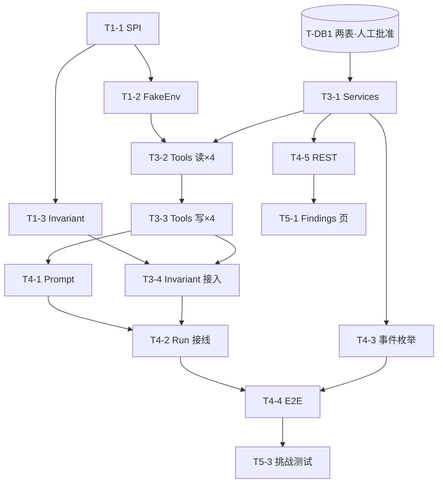

# AI Game Tester — 第一阶段开发任务树

> 2026-11-12 文档复核：本文为 T1–T7 历史任务清单；后续 T-N1..4 见 [演进设计](演进设计.md)，完成状态见 [task-state](../../state/task-state.md)。新作验收与真实适配不受历史 Fake-only 范围限制。

> 前置：`docs/projects/02_AI_Game_Tester/技术设计.md`（下称"技术设计"）。
> 编号规则：T-* 为 Tester 线 Task，与 Designer 线 P-* 不冲突。
> 执行模式：按工作流 v2，Sprint 内自主连续推进，Checkpoint 人工验收。

## Sprint T1 — 测试环境内核（无 Agent 依赖，可独立验证）

| Task | 名称 | 目标 | 前置 | 关键文件 | 验收标准 | 测试方式 |
|---|---|---|---|---|---|---|
| T1-1 | GameAdapter SPI + 模型 | 接口与 record 全集编译可用 | 无 | `gameenv/GameAdapter.java`, `GameSessionHandle`, `GameLaunchSpec`, `GameObservation`, `GameEvent`, `GameMetrics`, `GameAction` | 纯 Java 单测通过；不引新依赖 | 单测（record 构造/Jackson round-trip） |
| T1-2 | FakeGameEnvironment | 确定性 tick 状态机 + 故障注入 | T1-1 | `gameenv/FakeGameEnvironment.java` | ① 同 (seed, 动作序列, overrides) 双跑 Observation 序列逐字段一致；② 不同 seed 结果不同；③ 注入 hpNegativeAtTick 在指定 tick 触发 | 固定 seed 快照单测 ×3 组 |
| T1-3 | InvariantEngine | 谓词白名单解析+执行 | T1-1 | `tester/InvariantEngine.java` | 每条谓词正/反例各一通过；非法表达式报错明确 | 参数化单测 |

## Sprint T2 — 数据层（需人工批准 DB 变更后执行）

| Task | 名称 | 目标 | 前置 | 关键文件 | 验收标准 | 测试方式 |
|---|---|---|---|---|---|---|
| T-DB1 ★人工闸门 | 新增 test_plan / finding 两表提案→批准→实施 | 技术设计 §6 DDL 落 schema.sql；record + Repository 接口及 JdbcTemplate 实现 | 技术设计冻结 + 用户批准 | `schema.sql`(追加), `domain/TestPlan,Finding`, `repository/TestPlan*,Finding*` | 两 Repo CRUD/过滤查询全过；现有 10 表测试回归不变 | @SpringBootTest 临时库 |

## Sprint T3 — Tools 与服务层

| Task | 名称 | 目标 | 前置 | 关键文件 | 验收标准 | 测试方式 |
|---|---|---|---|---|---|---|
| T3-1 | TestPlanService + FindingService | Plan 模板生成/激活；Finding 校验落库 | T-DB1 | `tester/TestPlanService.java`, `FindingService.java` | DRAFT→ACTIVE 流转；非法 severity/category 被拒 | 集成测 |
| T3-2 | Tester Tools 前 4 个（读+启停） | test_plan_get / game_start / game_observe / game_collect_events 注册进 ToolRegistry | T1-2, T1-3, T3-1 | `tool/tester/*.java` | registry 含全部 Tester 工具且与 Designer 工具共存无重名；未知 sessionId 报错不致命 | 单测+集成 |
| T3-3 | Tester Tools 后 4 个（操作+产出） | game_act / game_collect_metrics / finding_report / test_report_create | T3-2 | 同上 | game_act 后 Observation 更新且 tool_call 落库；finding_report 落 finding 表并发事件；report 落 design_document(title 前缀) | 单测+集成 |
| T3-4 | InvariantEngine 接入观察链路 | observe/act 返回前自动执行，违反发 INVARIANT_VIOLATED 并附 violations 字段 | T1-3, T3-3 | `tool/tester/*`（observe/act 内） | 注入故障时 violations 出现在工具返回中且事件落 agent_event | 集成测 |

## Sprint T4 — Agent 接入与 E2E

| Task | 名称 | 目标 | 前置 | 关键文件 | 验收标准 | 测试方式 |
|---|---|---|---|---|---|---|
| T4-1 | tester_p001 Prompt + PromptService 导入 | Tester System Prompt 版本化 | T3-3 | `resources/prompts/tester_p001.md`, PromptService 追加导入逻辑 | 空库启动导入 p001 active；重复启动幂等 | @SpringBootTest |
| T4-2 | Run 启动接线（Agent 选择器） | task 带 ACTIVE plan 的 Run 使用 tester prompt+tools；否则走 Designer | T4-1, T3-2/3 | 最小侵入点：RunController 或新建 TesterService.startRun() 封装 | 同一 AgentLoop/ToolExecutor 不改动前提下两类 Run 均正常 | 集成测（FakeLlmGateway 双剧本） |
| T4-3 | 事件枚举追加 | 5 个 TEST_* 枚举值加入 AgentEventType | T3-1 | `event/AgentEventType.java` | 旧事件回归不变；新事件经 SSE 可见 | 回归+SSE 手测 |
| T4-4 ★E2E | Fake 全链路端到端 | FakeLlmGateway+FakeEnv：健康构建 0 Finding；注入构建 ≥1 Finding 且同 seed 重放复现相同 violation | T4-2 | `test/.../TesterEndToEndTest.java` | 总览 §8 判据 1~5 全过 | @SpringBootTest E2E |
| T4-5 | REST API | 技术设计 §9 七个端点 + 包络/错误码契约 | T3-1, T-DB1 | `api/TesterController.java`, `api/FindingController.java` | MockMvc 正常/异常/边界分支 | MockMvc |

## Sprint T5 — 前端最小增量 + 收尾

| Task | 名称 | 目标 | 前置 | 关键文件 | 验收标准 | 测试方式 |
|---|---|---|---|---|---|---|
| T5-1 | Findings 页 | 过滤表格+详情抽屉+status 操作 | T4-5 | `pages/FindingsPage.tsx`, `components/finding/*`, router | SSE 触发刷新；evidence 链到 Run Trace | 手动+dev emit |
| T5-2 | TestPlan 查看（并入 Findings 页或任务详情） | scenarios/invariants 展示 | T5-1 | 复用组件 | 计划与 Finding 可互相跳转 | 手动 |
| T5-3 | 挑战测试补全 | 技术设计 §12 六行挑战矩阵逐项落地为自动测试 | T4-4 | `test/.../TesterChallengeTest.java` | 矩阵全 PASS | 自动化 |
| T5-4 | 文档回写 | README/task-state 更新；C1 重命名执行（若批准） | T5-3 | docs | 与实际代码一致 | 人工审阅 |

## Checkpoint 设置

- **Checkpoint A**：Sprint T1 完成（环境内核可复现性证明）——轻量验收。
- **Checkpoint B**：Sprint T2 前（T-DB1 是唯一人工批准点：新增表）。
- **Checkpoint C**：Sprint T4 完成 = MVP 功能完整，输出完整 Sprint 报告等待验收。
- T5 属收尾，可与 Checkpoint C 反馈合并处理。

## 依赖图

并行说明：T1 线与 T-DB1 审批流程完全并行（审批期间先做 T1）；T3-2/T3-3 内部串行但与 T4-1 无耦合。

## 二期任务树占位（本阶段不实现）

- R1 结构化 Regression diff（finding 集合对比查询）
- R2 Stability 统计化（repeat≥100 + reproduction_rate 计算）
- R3 Balance Observation（经 simulate_game 复用 Experiment）
- R4 玩家人格策略库（Aggressive/Build Specialist/Exploit）
- R5 主动探索闭环（假设→重放实验→统计确认）
