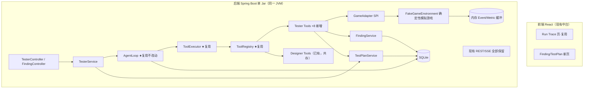

# AI Game Tester — 技术设计

> 2026-11-12 文档复核：本文保留 T1–T7 模拟测试基线；当前真实命令测试另见 [本地协议](../../platform/LOCAL_GAME_TEST_EXECUTION.md)。新作与跨游戏验收见 [演进设计](演进设计.md)，Runtime 语义以 [当前契约](../../platform/AGENT_RUNTIME_RECOVERY.md) 为准。当前 config_version 可承载经登记的 local- 版本，不能仅接受内置模拟版本。

> 上游：`docs/projects/02_AI_Game_Tester/架构设计.md`、需求文档 `产品定义.md`。
> 平台蓝图：`docs/projects/01_AI_Game_Designer/技术设计.md`（下称"蓝图"，其 §7/§8/§9/§11 为冻结契约）。
> 本文是可直接指导编码的工程蓝图。所有 id/字段/接口为约定。

---

## 1. 总体架构



关键决策：**Tester 不触碰 AgentLoop/ToolExecutor/ToolRegistry 的任何一行代码**。它通过"实现 `GameTool` 接口 + 注册为 Spring Bean"接入；FakeGameEnvironment 是 Tool 背后的普通 Java 组件。

---

## 2. 复用审查表（先复用后新增）

| 能力 | 已有基础设施 | Tester 是否直接复用 | 是否需要扩展 | 原因 |
|---|---|---|---|---|
| Agent Runtime | `AgentLoop` + `RunStateMachine` 7 态 | ✅ 直接复用 | 否 | Tester Run 就是普通 Agent Run；状态机语义完全够用 |
| Tool 执行编排 | `ToolExecutor`（落库/审批拦截/异常捕获） | ✅ 直接复用 | 否 | tool_call 表天然记录每次 game_* 调用 = 免费的执行证据链 |
| LlmGateway | 接口 + `LlmRequest/Response` DTO | ✅ 直接复用 | 否 | 测试期用 FakeLlmGateway；生产换 DeepSeekClient |
| Fake LLM | test 源集 `FakeLlmGateway` | ✅ 直接复用 | 否 | 需求文档要求 Agent 关键流程可用替身全跑通 |
| ToolRegistry | `GameTool` SPI + `ToolRegistry` | ✅ 直接复用 | 否 | Tester Tools 实现同一接口注册即可 |
| ToolContext | `(runId, stepId)` record | ⚠️ 复用 | **微扩展** | Tester Tool 需知道被测 configVersion 与 gameSessionId → 通过 Tool 参数显式传入而非改 ctx（避免动冻结契约） |
| Project/Task | `task` 表 | ✅ 复用（Test Request 即 task 行） | 否 | goal=测试目标，constraints_json 存 {configVersion, planMode} |
| Run/Step/ToolCall | 同名表 | ✅ 直接复用 | 否 | 无需 tester_run/tester_step/tester_event |
| Experiment | `experiment` 表 | ✅ 复用 | 否 | Balance Observation 类测试直接产 experiment 行（契约 2） |
| AgentEvent + SSE | `agent_event` 表 + Publisher + SseController | ✅ 复用 | **新增事件类型** | 新增 TEST_PLAN_CREATED / GAME_SESSION_STARTED / INVARIANT_VIOLATED / FINDING_CREATED / TEST_REPORT_CREATED 五个枚举值（追加不改旧值） |
| Dashboard/中台 | React 中台 | ✅ 复用框架 | 新增 1~2 页 | Finding 列表页、TestPlan 详情（可并入 Finding 页） |
| SQLite | schema.sql IF NOT EXISTS | ✅ 复用 | **新增 2 张表** | 见 §6 |
| PromptVersion | `prompt_version` 表 + PromptService 模式 | ✅ 复用模式 | 新增 `tester_p001.md` | version 前缀区分 agent 类型 |
| ConfigVersion | `game_config_version` 表 | ✅ 复用（只读） | 否 | 被测对象；Tester 禁止写 Config |
| DesignDocument | `design_document` 表 | ✅ 复用 | 否 | Test Report 以 markdown 落此表（title 前缀 `[TEST REPORT]`）——它是通用 Artifact 表，语义匹配 |
| ApiResp/ErrorCodes | common 包 | ✅ 直接复用 | 否 | 六码错误契约不变 |

**结论：零新增基础设施，仅 2 张业务表 + 1 组工具 + 1 个环境包。**

---

## 3. GameAdapter SPI 与 FakeGameEnvironment

### 3.1 抽象层（新包 `com.aigamelab.gameenv`）

```java
/** 游戏测试环境抽象：未来 WebGameAdapter/UnityAdapter 实现同一接口 */
public interface GameAdapter {
    String id();                                   // "fake-orbital-v1"
    GameSessionHandle start(GameLaunchSpec spec);  // 启动会话（含 seed/configVersion）
    GameObservation observe(String sessionId);     // 全量状态快照
    List<GameEvent> drainEvents(String sessionId); // 取走增量事件（drain 语义）
    GameMetrics metrics(String sessionId);         // 累计指标
    void stop(String sessionId);                   // 结束会话
}

/** 一次动作；actionType 开放字符串 + 参数 JSON，不枚举封闭（需求文档接口风格）*/
public record GameAction(String actionType, JsonNode params, int tickBudget) {}
// actionType MVP: MOVE / ATTACK / CHOOSE_UPGRADE / WAIT / RESTART
```

- `GameLaunchSpec`: seed, configVersion(只读快照), overridesJson(Boundary 注入), playerProfile(Random/Scripted)。
- `GameObservation`: tick, phase(LOBBY/BATTLE/Settlement...), hp/maxHp/enemyCount/projectileCount/score/position/level/upgrades[]/flags{} —— 对齐需求文档 §3 状态示例。
- `GameEvent`: tick, type(SPAWN/DEATH/LEVEL_UP/PHASE_CHANGE/INVARIANT_CANDIDATE...), payload。
- `GameMetrics`: ticksElapsed, damageDealt/Taken, kills, deaths, actionsExecuted, uptimeMs。
- 会话句柄 `GameSessionHandle(sessionId, adapterId)`；sessionId 由 Adapter 分配并在 Tool 层映射到 runId。

### 3.2 FakeGameEnvironment（确定性）

- 内部是一个**极简 tick 状态机**（与 Designer 的数值 Simulation Engine 不同物：Simulation 是批量无状态聚合器；FakeEnv 是单会话有状态机，供逐步 observe→act）。
- 确定性来源：所有随机经注入 `SplittableRandom(seed)`，动作按 tick 定序消费 ⇒ 同 (seed, 动作序列, overrides) 必得相同 Observation 序列（工作流 §17 要求）。
- **故障注入**：`overridesJson` 支持 `{"inject":{"hpNegativeAtTick":500,"stuckPhase":"BATTLE"}}` 等，用于验证 Invariant 引擎与 Agent 分析能力（对应总览 §8 成功判据 3/4）。
- MVP 规模：单文件 ~300 行，纯 JDK+Jackson，无任何依赖。
- 未来适配位：WebGameAdapter（HTTP 驱动）、UnityAdapter（插件）实现同一 SPI，Tools 层不变。

---

## 4. Tester Tools（8 个，注册进现有 ToolRegistry）

| # | name | 权限 | 需审批 | 职责 |
|---|---|---|---|---|
| 1 | `test_plan_get` | READ | 否 | 读取当前 task 关联的 TestPlan（含场景列表/invariants/seed） |
| 2 | `game_start` | EXECUTE | 否 | 按 plan 场景启动/重启会话（RESTART 场景间隔离）；返回 sessionId+初始 Observation |
| 3 | `game_observe` | READ | 否 | 返回当前 Observation 快照（紧凑文本/JSON，截断 ≤4000 字符同蓝图规则） |
| 4 | `game_act` | EXECUTE | 否 | 执行一个 GameAction，返回执行后 Observation 摘要 |
| 5 | `game_collect_events` | READ | 否 | drain 自上次以来的 GameEvent 列表 |
| 6 | `game_collect_metrics` | READ | 否 | 返回累计 Metrics |
| 7 | `finding_report` | WRITE | 否 | 上报结构化 Finding（severity/type/expected/actual/repro steps/evidence 引用） |
| 8 | `test_report_create` | WRITE | 否 | 生成 Markdown 测试报告落 design_document 表，发 TEST_REPORT_CREATED |

设计要点：

- 工具粒度对齐蓝图 §11 模式（输入明确/输出明确/Schema 明确/错误明确），全部走 `ToolExecutor` ⇒ 每次 game_act 自动落 `tool_call` 行，**执行证据链免费获得**。
- `game_act` 的 args 含 `sessionId`，由 FakeEnv 校验归属（防跨 run 操作他方会话）。
- 不设 `requiresApproval=true` 工具（MVP 无真实副作用）；未来真机 stop_game 再启用审批路径——平台已内建该机制，无需开发。

---

## 5. Test Plan 设计

```json
{
  "taskId": 12,
  "configVersion": "v001",
  "mode": "SCRIPTED",
  "scenarios": [
    {
      "id": "smoke-main-flow",
      "type": "SMOKE",
      "goal": "启动→战斗30s→存活",
      "seed": 42,
      "repeat": 1,
      "playerProfile": "SCRIPTED",
      "invariants": ["HP>=0", "HP<=MaxHP", "ENEMY_COUNT<=ENEMY_CAP", "TICK>=0", "PHASE_LEGAL"]
    },
    {
      "id": "boundary-hp1",
      "type": "BOUNDARY",
      "goal": "1 HP 下不被非法状态卡死",
      "seed": 43,
      "overrides": {"player.maxHp": 1},
      "invariants": ["HP>=0", "PHASE_LEGAL"]
    }
  ]
}
```

- 存储：新表 `test_plan`（§6）。Test Request 创建时由 TesterService 从模板生成 DRAFT，Agent 可经 `test_plan_get` 读到并按其推进（MVP 中 Plan 由服务端模板化生成 + 用户可编辑 constraints_json 微调；LLM 全自动生成 Plan 属二期）。
- Invariant 格式：内置谓词白名单（`HP>=0`、`HP<=MaxHP`、`ENEMY_COUNT<=CAP`、`PHASE∈{LOBBY,BATTLE,SETTLEMENT,GAME_OVER}`、`SCORE>=0`、`POSITION_VALID`），由 `InvariantEngine` 在**每次 game_observe/game_act 返回前自动执行**，违反即：① 发 `INVARIANT_VIOLATED` 事件 ② 在 Observation 附 `invariantViolations[]` 字段让 LLM 当轮看到 ③ 由 Agent 决定是否升级为 finding_report。引擎本身是确定性代码，不依赖 LLM——保证已采样状态的已注册规则得到检查，不保证未采样状态无问题。

---

## 6. 数据库影响

### 结论：新增 2 张表（独立 DB Task 提案，人工批准后实施）

为什么共享模型不够：

| 候选 | 为什么不行 |
|---|---|
| 塞 task.constraints_json | Plan 是结构化多场景对象，需要独立 CRUD/版本对比/回归引用；且 task 行会被 UI 编辑污染 |
| 塞 experiment.result_json | Finding 不是实验：无幂等键、有 severity/status 流转、需按版本聚合查询（回归对比的核心查询路径） |
| design_document 存 Finding | Markdown 无法做 `WHERE config_version=? AND severity='HIGH'` 的结构化查询，Designer 消费困难 |
| agent_event.payload | 事件是 append-only 日志不是可更新实体 |

### DDL（提案）

```sql
-- 测试计划（一次测试任务的计划实体）
CREATE TABLE IF NOT EXISTS test_plan (
    id INTEGER PRIMARY KEY AUTOINCREMENT,
    task_id INTEGER NOT NULL REFERENCES task(id),
    config_version TEXT NOT NULL,
    status TEXT NOT NULL DEFAULT 'DRAFT',   -- DRAFT/ACTIVE/COMPLETED
    scenarios_json TEXT NOT NULL,           -- 场景数组（§5 结构）
    created_at TEXT NOT NULL DEFAULT (datetime('now','localtime'))
);
CREATE INDEX IF NOT EXISTS idx_tp_task ON test_plan(task_id);

-- 缺陷/发现（Tester 的一等产出，供 Designer/Builder 消费）
CREATE TABLE IF NOT EXISTS finding (
    id INTEGER PRIMARY KEY AUTOINCREMENT,
    run_id INTEGER REFERENCES run(id),
    test_plan_id INTEGER REFERENCES test_plan(id),
    task_id INTEGER REFERENCES task(id),
    scenario_id TEXT NOT NULL,
    config_version TEXT NOT NULL,           -- 冗余列：回归对比核心查询路径
    severity TEXT NOT NULL,                 -- BLOCKER/HIGH/MEDIUM/LOW/INFO
    category TEXT NOT NULL,                 -- CRASH/SOFT_LOCK/INVARIANT_VIOLATION/UNEXPECTED_STATE/BALANCE_ANOMALY/OTHER
    title TEXT NOT NULL,
    expected TEXT,
    actual TEXT,
    repro_steps TEXT NOT NULL,              -- Markdown 步骤（含 seed/action sequence）
    evidence_json TEXT NOT NULL DEFAULT '{}', -- {toolCallIds:[], observationSnapshot:{}, events:[]}
    reproduction_rate REAL,
    status TEXT NOT NULL DEFAULT 'OPEN',    -- OPEN/CONFIRMED/DISMISSED/FIXED
    created_at TEXT NOT NULL DEFAULT (datetime('now','localtime'))
);
CREATE INDEX IF NOT EXISTS idx_finding_ver_sev ON finding(config_version, severity);
```

明确不做：tester_run/tester_step/tester_event/tester_project 一律不加（工作流 §十 禁止项）。

---

## 7. Finding / Evidence 设计

Finding 字段承接需求文档 §8 Bug 报告并扩展：

- `severity/category/title` — 需求文档字段直译。
- `repro_steps` — 必含 `seed + scenarioId + actionSequence(toolCallId 区间)`，满足"完整 reproduction sequence"硬要求。
- `evidence_json.toolCallIds` — 指向 tool_call 表行（observation 原文、events 原文都在那里），**证据不复制、只引用**，避免双写漂移。
- `reproduction_rate` — 二期主动探索（假设→N 次重放→统计）回填；MVP 由 LLM 单次判定时留空。

---

## 8. Agent Prompt（tester_p001 草稿）

> 你是 AI Game Tester，负责 PROJECT ORBITAL 构建版本的自动化测试。
>
> 工作循环：**PLAN（读 test_plan_get）→ SETUP（game_start）→ SCENARIO_LOOP（game_observe → 检查 invariantViolations → game_act / game_collect_events / game_collect_metrics → 推进）→ ANALYZE → REPORT**。
>
> 铁律：
> 1. 每个 scenario 必须从 `game_start` 开始，结束于 GAME_OVER/结算或达到 goal 条件。
> 2. Observation 中出现 `invariantViolations` 时，必须核实上下文（collect_events）后调用 `finding_report`，不得忽略。
> 3. 所有判断必须基于工具返回的真实 Observation，禁止臆测游戏状态。
> 4. finding_report.repro_steps 必须能让他人用相同 seed 重放。
> 5. 所有场景完成后必须调用 `test_report_create` 输出报告（覆盖：每场景结果/Finding 清单/风险评级/建议），然后结束。
> 6. 达到 Max Steps/Token 预算时立即出简版报告收尾。

---

## 9. API 设计（新增端点，全部走现有包络/错误码）

| 方法 | 路径 | 说明 |
|---|---|---|
| POST | `/api/tasks/{id}/test-plan` | 由 TesterService 生成 DRAFT Plan（依据 task.constraints） |
| GET | `/api/test-plans/{id}` | Plan 详情 |
| PUT | `/api/test-plans/{id}` | 用户编辑 scenarios/invariants |
| POST | `/api/test-plans/{id}/activate` | DRAFT→ACTIVE（此后才允许起 Run） |
| GET | `/api/findings?configVersion=&severity=&runId=` | Finding 列表（过滤） |
| GET | `/api/findings/{id}` | Finding 详情（evidence 解析） |
| POST | `/api/findings/{id}/status` | 人工确认/驳回 `{status,comment}` |

执行仍走现有 `POST /api/tasks/{id}/runs`（Run 启动时若 task 带 ACTIVE Plan 则注入 tester prompt + tools）。

## 10. SSE / Event 设计

复用整条 publish→落库→SSE 链路，仅在 `AgentEventType` **追加**六个枚举：

```text
TEST_PLAN_CREATED / TEST_PLAN_ACTIVATED / GAME_SESSION_STARTED
INVARIANT_VIOLATED / FINDING_CREATED / TEST_REPORT_CREATED
```

payload 示例（INVARIANT_VIOLATED）：`{"scenarioId":"smoke-main-flow","invariant":"HP>=0","tick":512,"observed":-3}`。前端现有 useGlobalSse/useRunSse 无需修改即收到信号；Finding 页订阅 global 流触发 refetch。

## 11. 前端 / Dashboard

MVP 最小增量（其余全部复用现有四页）：

- 新页 `/findings`：过滤表格（version/severity/status/scenario）+ 详情抽屉（expected vs actual + repro 步骤 + evidence 链接到 Run Trace 锚点）+ status 操作按钮。复用 Experiment Center 的表格/抽屉组件模式与 SSE hook。
- Run Trace 页零修改即显示 Tester Run（step 时间线里出现 game_* 工具名，天然可读）。
- Dashboard stats 扩展一个 tile（OPEN Findings 数）——可选。

## 12. Agent 状态机与执行流

运行时状态机 = 平台 7 态（见总览 §4）。逻辑阶段在 Prompt 中约定，落库可见性靠：

- Step.llm_content = 模型决策摘要（"开始 smoke-main-flow 场景"）
- tool_call 序列 = 精确执行轨迹（game_start@t0 … game_act×n）
- agent_event = 领域里程碑（session started / invariant violated / finding / report）

挑战测试矩阵（工作流 §25，核心模块必须制造失败）：

| 注入 | 预期 |
|---|---|
| FakeEnv 故障注入 hp<0 | INVARIANT_VIOLATED 事件 + Finding(HIGH) |
| FakeEnv 卡死在某 phase | PHASE_LEGAL/超时步数收口 + Finding(SOFT_LOCK 类) |
| game_act 传非法 sessionId | ToolException→FAILED tool_call，Run 继续 |
| LLM 连续同参 game_act ×3 | LoopDetector 强制收口（平台既有能力） |
| maxSteps=5 小预算 | BudgetGuard 触顶 FAILED，报告标记未完成场景 |
| 会话中途进程重启 | RunRecoveryService 续跑（observe 从 DB 重建，FakeEnv 会话丢失→game_observe 报错→LLM 重启会话恢复）|

最后一行的取舍：MVP 不做 FakeEnv 会话持久化（技术债登记）；恢复路径为"报错→Agent 重启场景"，符合"环境可重复"前提下结果不变。

## 13. 测试策略（对照工作流 §十八）

| 层 | 内容 |
|---|---|
| Unit | InvariantEngine 谓词逐条；FakeEnv 确定性（同 seed 双跑 Observation 序列相等）；FindingService 校验 |
| Integration | FakeLlmGateway 剧本驱动 AgentLoop：plan→start→act×3→finding→report→COMPLETED 全链路（临时 SQLite） |
| Tool | 8 个 Tool 合法/非法/边界参数；未知 sessionId；跨 run 访问被拒 |
| E2E（Fake 全链路） | 健康构建→0 Finding；注入构建→≥1 Finding 且 repro 可重放（重放断言：同 seed 同动作序列二次执行产生相同 violation tick） |
| 回归 | 现有全部测试不受影响（Tester 未改任何既有类） |

## 14. 风险与技术债

1. **FakeEnv 与 Designer Simulation 双模型并存**：一个是单会话状态机、一个是批量聚合器。二者共享 GameConfig 形状但代码不同。技术债：二期评估统一底层内核（Simulation 提供"单局步进 API"供 FakeEnv 包一层）。
2. **LLM 判断质量依赖 Prompt**：MVP 用 InvariantEngine 检查已注册且被采样的谓词，LLM 只负责解释与升级——误报可控，漏报由确定性引擎拦截。
3. **Regression 对比靠 LLM 阅读 Finding diff**：二期做结构化 finding diff 查询。
4. **会话不持久化**：见 §12 取舍。
5. **design_document 复用为报告载体**：title 前缀约定属弱约束，若后续 Artifact 表落地则迁移（架构文档 §8 本就规划 project_artifact）。

## 15. Architecture Conflict Report

| # | 冲突点 | 当前设计 | Tester 需求 | 方案 | 推荐 |
|---|---|---|---|---|---|
| C1 | `docs/projects/` 下两个 `02_` 前缀文件（Designer 技术设计 vs Tester 需求）命名冲突 | 并存 | — | A. 重命名 Tester 需求文档为 `04_AI自动测试游戏Agent_需求.md` B. 保持不动 | A（纯文档整理，不影响代码；待批准后执行） |
| C2 | 需求文档的 `get_screenshot()` 接口 vs 平台"第一阶段不做 CV/截图"约束 | 总架构限制 | 需求文档列了 screenshot | 按用户指令优先级（工作流 §41：当前用户要求 > 需求文档），第一阶段不实现 screenshot；GameObservation 结构预留 `screenshotRef` 字段位 | 按阶段裁剪，非冲突 |
| C3 | 新增 2 张表 vs "不随便加表" | 共享模型 | Plan/Finding 需结构化查询 | §6 已给替代方案排除表 | 新增 2 张表，作为独立 DB Task 提请批准 |

无阻断性冲突。C1/C3 需要人工点头，但不阻塞设计冻结与其余 Task 开发。
